# herdr-channels

Slack-style channels for the [herdr](https://herdr.dev) app, backed by Claude Code and running
entirely on your machine.

A channel groups the work on one topic. Each channel has an icon, a description, a long-lived
Claude Code chat, a list of tasks, and routines: prompts its chat receives on a schedule. A task is a Claude Code background session (`claude --bg`)
that you can open live in the tasks panel next to the chat. The chat can start tasks, read them and
send them messages. When a task finishes or asks a question, the tasks panel shows it, a card above
the chat's prompt lets you answer or dismiss it without the chat taking a turn, and the chat hears
about it with your next message; it is interrupted only when it asked to be.

Everything is local: the channel store is a folder on disk, tasks run under your own `claude`, and
the herdr mod runs every command on the same machine. No server is involved, unless you turn on
[cloud tasks](#cloud-tasks) (off by default), which run tasks at claude.ai/code.

![The channels layout in Herdr: the channel list on the left, where #website has a red dot on its icon for the task waiting on you, with Herdr's spaces list below it; the #website channel's Claude Code chat in the middle, where one-line notices from the Add a contributing guide and Add a page title tasks are followed by the chat saying in a few lines what they did, above a task card saying Pick a homepage headline waits on a permission prompt; and the tasks panel on the right with one task that needs input, one working and two ready for review](preview.png)

## Contents

| Path | Purpose |
|---|---|
| `mods/channels/` | The herdr mod: sidebar (channels, and Herdr's own spaces), header bar, tasks panel and dialogs; `backend.js` says where its store is ([on another machine](#a-store-on-another-machine)) |
| `mods/claude/` | The Claude Code mod each channel's chat loads: the [task cards](#task-cards) above its prompt |
| `layouts/channels.json` | The herdr layout that arranges the mod |
| `bin/channels.mjs` | The `channels` command (a Node script, no dependencies) |
| `bin/schedule.mjs` | Routine schedules: parsing, and when a routine is due |
| `bin/routines.mjs` | The routine engine and its words: adding and changing routines, which runs are due, the message a run types into the chat. It touches no file, so a store on another machine can run the same copy |
| `bin/harness/` | The coding agents a task runs on, one module each behind the same interface ([docs/harnesses.md](docs/harnesses.md)): `claude.mjs` is Claude Code's sessions, records and messages; `codex.mjs` is [Codex tasks](#codex-tasks) and [a Codex chat](#a-codex-chat) |
| `bin/codex-rpc.mjs` | [Codex tasks](#codex-tasks): every call to Codex's app-server (its background service), standalone |
| `bin/cloud.mjs` | [Cloud tasks](#cloud-tasks): every call to Claude Code's private sessions API, standalone |
| `bin/release.mjs` | [Versions and updates](#updating): the installed version, the check against GitHub Releases, `channels update` |
| `install.mjs` | Installer for the command, mod and layout |
| `test/` | Tests for the command and the installer |
| `preview.png`, `docs/` | Screenshots of the layout, taken in a sandbox with demo channels |

## Requirements

- macOS
- The [Herdr desktop app](https://herdr.dev/download) (Herdr.app, Apple silicon), opened at least
  once (this creates `~/.config/herdr-app` and installs `hc`, the herdr-core CLI). The separate
  `herdr` terminal app (TUI) can't load mods, so it isn't enough on its own.
- Node.js 20 or later (`brew install node`)
- [Claude Code](https://claude.com/claude-code), signed in
- `python3` and `git`, both included with the Xcode Command Line Tools

## Installation

1. Install Node.js:

   ```sh
   brew install node
   ```

2. Clone the repository. The installed command runs from the clone, so keep it in place:

   ```sh
   mkdir -p ~/projects && cd ~/projects
   git clone https://github.com/bensoutendijk/herdr-channels
   ```

3. Trust the projects folder in Claude Code. Background sessions only start in a trusted folder.
   Run `claude` there, accept the trust prompt, then type `/exit`:

   ```sh
   cd ~/projects && claude
   ```

4. Install the Herdr desktop app, then open it once so that its configuration folder and `hc`
   exist. It updates itself after this:

   ```sh
   curl -fsSL https://releases.herdr.dev/app/install.sh | sh
   ```

   Or download [Herdr.dmg](https://releases.herdr.dev/app/Herdr.dmg) and drag it to Applications.

5. Run the installer:

   ```sh
   node ~/projects/herdr-channels/install.mjs
   ```

6. If `~/.local/bin` is not on your `PATH`, add it so `channels` is available in a terminal. The mod
   and the chats find the command without this step.

   ```sh
   echo 'export PATH="$HOME/.local/bin:$PATH"' >> ~/.zshrc && exec zsh
   ```

7. Verify the installation:

   ```sh
   herdr-app check ~/.config/herdr-app/mods/channels
   channels create general
   channels list
   ```

   herdr now shows the channels layout with `#general` in the sidebar. Select it to open its chat.
   Press `ctrl-shift-l` to switch between layouts.

### Installer options

The installer:

- writes the `channels` command to `~/.local/bin`,
- copies the mod and layout into `~/.config/herdr-app`,
- copies the task cards mod (`mods/claude`) to `~/.local/share/herdr-channels/chat-mod`, which
  every channel's chat loads,
- selects the channels layout, and
- adds the routines timer: a launchd user agent, `~/Library/LaunchAgents/dev.herdr-channels.tick.plist`,
  that runs `channels tick` every minute (see [Routines](#routines)).

On a first install in a terminal, the installer asks whether to turn on [Remote Control](#remote-control);
the answer is no unless you type `y`. An install with neither `--remote-control` nor `--no-remote-control`
keeps what the Mac had. [Cloud tasks](#cloud-tasks) are never asked about: they stay off unless
`--cloud` turns them on. [Codex tasks](#codex-tasks) are on when the installer finds `codex`, unless `--no-codex`
turns them off; Claude Code stays the default either way.

It never overwrites existing files. If a mod or layout named `channels` already exists and was not
installed by this repository, the copy is installed under the next free name (`channels-2`, and so
on). Running the installer again updates a previous installation in place.

| Option | Default | Description |
|---|---|---|
| `--projects <dir>` | `~/projects` | Folder where chats and tasks start |
| `--store <dir>` | `~/.local/state/herdr-channels` | Where channels are stored |
| `--by <name>` | `user` | Name recorded when a task is resolved from the panel |
| `--bin <dir>` | `~/.local/bin` | Where the `channels` command is written |
| `--chat-mod <dir>` | `~/.local/share/herdr-channels/chat-mod` | Where the chats' task cards mod is copied |
| `--app-home <dir>` | `$HERDR_APP_HOME` or `~/.config/herdr-app` | herdr configuration folder |
| `--label <label>` | `dev.herdr-channels.tick` | The launchd label of the routines timer |
| `--remote-control` | off | Show this Mac's channel chats and tasks at claude.ai/code and in the Claude app (see [Remote Control](#remote-control)) |
| `--no-remote-control` | | Turn Remote Control off again |
| `--cloud` | off | Let channels run tasks as Claude Code cloud sessions; reads Claude Code's stored login and calls its private API (see [Cloud tasks](#cloud-tasks)) |
| `--no-cloud` | | Turn cloud tasks off again |
| `--codex` | on when `codex` is found | Let tasks run on OpenAI's Codex CLI as well as Claude Code (see [Codex tasks](#codex-tasks)) |
| `--no-codex` | | Turn Codex tasks off again |
| `--no-timer` | | Install without the routines timer |
| `--no-switch` | | Install without selecting the layout |
| `--dry-run` | | Show what would be installed without writing anything |
| `--name <name>` | `channels` (or the next free name) | The mod and layout's name, to install beside another channels mod |
| `--uninstall` | | Remove what the installer added (see [Uninstalling](#uninstalling)) |

### A store on another machine

The mod can also front a channels store that lives on another machine Herdr reaches (one from
`hc machine ls`): a home server whose own `channels`-style command keeps the channels, runs each
channel's chat, and files tasks from several computers. Then only the mod and its layout are
installed on this Mac; the store, its chats and their schedule stay on the server.

```sh
node install.mjs --on server --command "hub channels" --local laptop \
  --projects /home/me/projects --by me --name channels-hc --no-switch
```

| Option | Meaning |
|---|---|
| `--on <machine>` | The Herdr machine the store's command runs on |
| `--command <command>` | That command, as words (`hub channels`); it runs with the server's `~/.local/bin` on `PATH` |
| `--local <name>` | What the store calls this computer: its tasks here are filed as `<name>/<session>`. Required, because the store's own `list --json` names the server, not this Mac |
| `--projects <dir>` | The folder on the server where a chat and a fresh session start |
| `--by <word>` | Who a task resolved from the panel is recorded as; use a word the store accepts |

With a store on another machine:

- Tasks open on the machine they run on: this Mac's in a local terminal, the server's and any other
  machine's through Herdr (`hc run --on`), when Herdr reaches that machine. Their standing comes from
  `claude agents` on the server and on this Mac; a task on a third machine takes the `standing` the
  store gives in `list --json` (`needs`, `working` or `ready`), if it gives one.
- The mod asks the command what it can do, once each time it loads: `<command> capabilities --json`
  prints `{ "features": [...] }`. A command that doesn't know that question is judged by its
  `list --json` (`features`, if it gives them). What the command lacks is hidden rather than offered
  and refused. A command that lists no features gets the basics only (channels, chats, tasks,
  resolve, rename, icon, instructions, archive). The features are `chat-bg` (the chat in a background
  terminal), `seen` (unread dots, and bold names in the sidebar), `refresh` (the Refresh row, from `updates` in `list --json`),
  `routines`, `rename-task` and `refresh-all` (Refresh all chats: `<command> refresh --all --json`,
  which prints `{ "summary": "..." }`). A task's `asking` in `list --json` (`{ state, at }`: a
  `question`, `prompt` or `approval`, and when it was filed) lets the sidebar stop marking a question
  nobody answered in two days; without it, every waiting task is marked.
- With the `routines` feature, the server keeps the routines and its own timer fires them, so they run
  while this Mac sleeps. The Routines dialog says schedules are the server's local time. The server's
  command takes the same `routine …` commands and gives the same `routines` and `queued` in
  `list --json` as this repo's; `bin/schedule.mjs` has no imports, so it can carry a verbatim copy of
  it, and schedules and catch-up behave the same.
- Updates come from GitHub Releases here too. The install keeps a small folder of its own
  (`~/.local/state/herdr-channels/<name>`: the version installed, the options it was given, the last
  check). The mod asks this clone's `channels update --status` every few minutes, which asks GitHub
  at most every 4 hours, and shows the same "herdr-channels X.Y.Z available · Update" row. Update
  fast-forwards this clone to the release tag and installs the mod again with the same options. The
  mod reloads, and the chats on the server keep running. Nothing updates until you click. An install
  from before this needs one run of the `install.mjs --on …` line to set it up.
- With the `chat-bg` feature, a channel's chat runs in a terminal of its own on the server
  (`<command> chat <name> --bg --json` starts it, or finds the one it runs in), shown as a tab in the
  server's `channels` space. A chat already running in a `#<channel id>` tab there is shown as it is
  until it ends.
- Without it, a channel's chat is a tab named `#<channel id>` in the server's `channels` space,
  running `<command> chat <name>` there. A tab already running it is reused. One whose program ended
  is replaced, so the chat starts again on its session, unless it ended within seconds of starting.
- The sidebar's foot shows the server and whether Herdr reaches it.

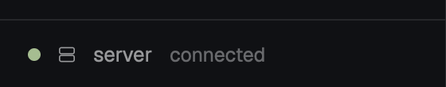
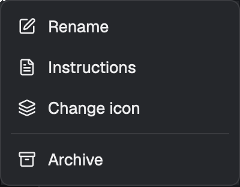
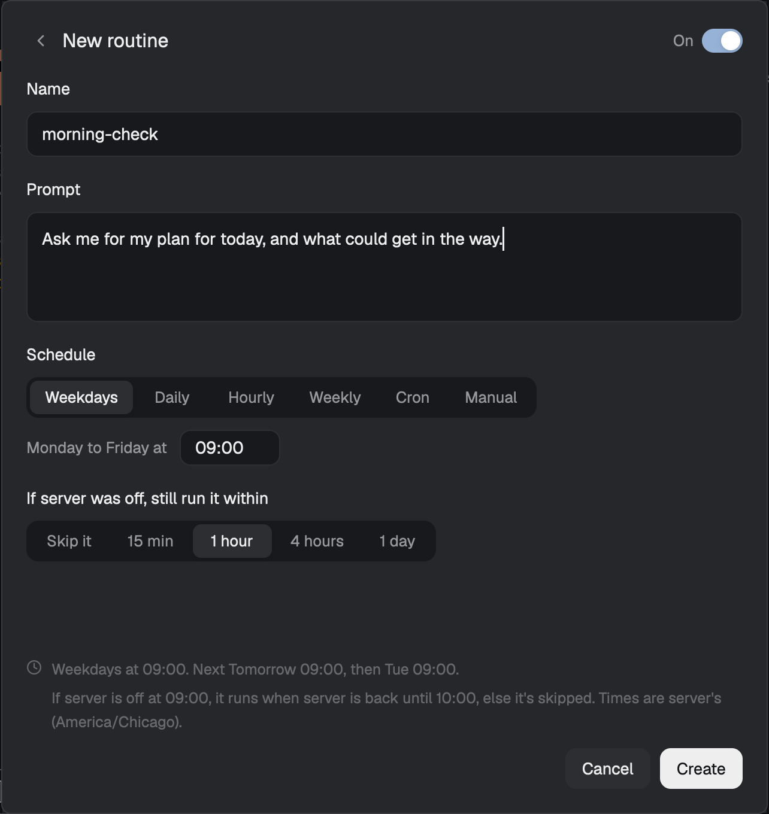

The mod keeps its state under its own name (`channels-hc.data`, ...), so a copy installed this way
beside another channels mod never reads the other's. To go back, switch layouts (`⌘⇧L`, or
`herdr-app do layout.switch --name channels`); `node install.mjs --uninstall` removes only the
copies this repository installed.

### Updating

herdr-channels is released on GitHub: every merge to `main` that adds a feature or a fix is tagged
`vX.Y.Z` and published as a [GitHub Release](https://github.com/bensoutendijk/herdr-channels/releases)
with its notes ([CHANGELOG.md](CHANGELOG.md) keeps them all). The installer records the version of
the clone it installs from, and the sidebar's footer shows it.

The routines timer looks up the latest release every four hours: one unauthenticated request to
`api.github.com/repos/bensoutendijk/herdr-channels/releases/latest`, with nothing in it about the
Mac or its user. When a newer release is out, a row under the channels in the sidebar says so, with a link
to its release notes and an **Update** button. Nothing is updated until the button is clicked.

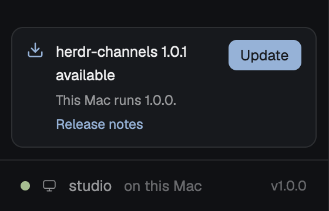

Update, or the same from a terminal:

```sh
channels update --check   # is there a newer release? (asks GitHub now)
channels update           # install it
```

`channels update` fast-forwards the clone to the release's tag and runs the installer again with the
options the last install was given (recorded in the store, as `install.json`). It changes nothing,
and says why, when the clone has changes not committed or commits that aren't in the release. Set
`CHANNELS_UPDATE_CHECK=off` in the command's environment to stop the timer's lookups.

To update by hand instead, or from a clone without release tags:

```sh
cd ~/projects/herdr-channels && git pull && node install.mjs
```

Pass the same options as the first install (for example `--projects ~/code`). Installing again also
adds the routines timer to an installation that doesn't have it yet.

Either way, that is the whole update. Herdr reloads the mod when its files change. The installer stamps the new
build and restarts every running chat on it, on the same session with its history: an idle chat at
once, and a chat in the middle of a turn by itself within seconds of that turn ending. The
installer's summary says which chats restarted and which wait. Nothing needs `/exit` by hand.

Claude Code updates itself. A chat keeps running the version it started with, so when a newer one is
installed, a **Refresh** row appears under the channels in the sidebar, saying which version is new and
how many chats run an older one. Clicking Refresh restarts the idle chats on it now and the rest as
their turns end, and the row then says what it did. The row shows only while a chat is behind.

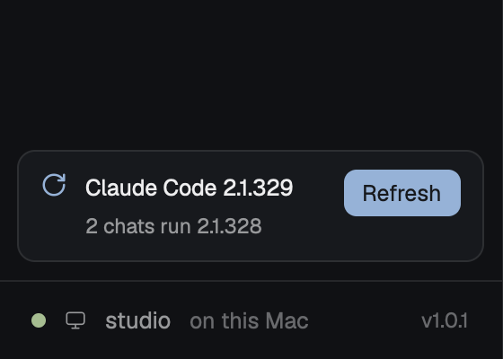
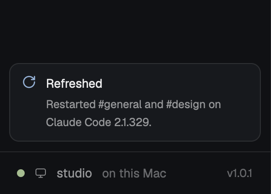

A restart never interrupts a turn or loses a draft. A chat is restarted only while Claude Code
reports it idle, herdr-core reports its terminal not working, and its prompt is empty; then its
`claude` is stopped and the chat starts again by itself in the same terminal. A chat with a draft
typed in its prompt waits until the draft is sent or cleared.

Refresh applies what is installed; it doesn't pull this repository or run `claude update`. Tasks are
never restarted: `channels send` restarts a task's process for each message, so a task runs the
newest Claude Code from its next message on.

Some things a chat reads only when it starts, with nothing newer installed: an organization turning
on Claude Code channels, say, or other account settings. To restart every chat anyway, open the `···`
next to **Channels** at the top of the sidebar and pick **Refresh all chats** (or run `channels
refresh --all`). The same rules hold: idle chats restart now, a chat mid-turn when its turn ends, a
chat with a draft once its prompt is empty. The sidebar shows Refreshing… and then what it did.

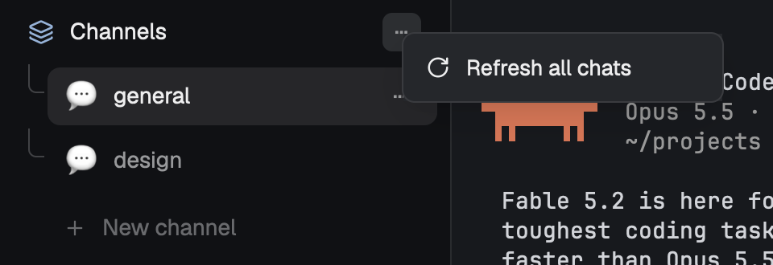

Herdr's command palette (⌘⇧P) lists only Herdr's own commands; a mod can't add to it. For a key
instead, bind the mod's `refresh-all` command in `~/.config/herdr-app/keys.json` (the mod's name is
`channels` unless you installed it with `--name`):

```json
{ "global": { "cmd-shift-r": "channels.refresh-all" } }
```

With a store on another machine, the menu item and the key work only when that machine's command
lists the `refresh-all` feature.

## Usage

- **Channels.** Create a channel with **New channel** at the bottom of the sidebar. Use a channel's
  `···` menu to rename it, edit its instructions (the description its chat reads at startup), set
  up its routines, change its icon or archive it. Drag channels to reorder them. A small clock next
  to a channel's name means it has a routine switched on: hover it for the next run, click it to
  open the channel's Routines.

  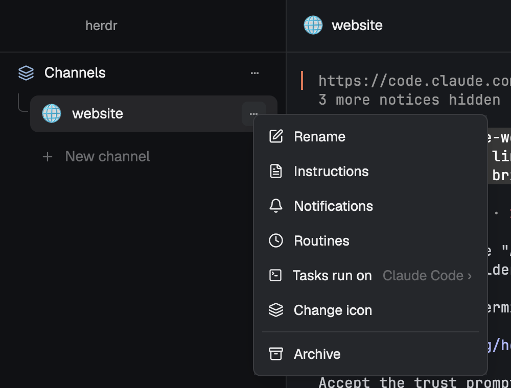

- **What waits for you.** A red dot on a channel's icon means one of its tasks needs you: a question,
  a permission prompt or a Codex approval (hover the icon for how many). A channel's name turns bold
  while something in it waits on you or hasn't been seen, such as a task that finished since you last
  opened it in the tasks panel. A question nobody answered in two days stops counting, as its card
  goes then; the task still waits under *Needs input*. Archived channels aren't listed. With a store
  whose command has no `seen`, only what needs you is marked; one that doesn't say when a task asked
  (no `asking` in `list --json`) has every waiting task marked.

  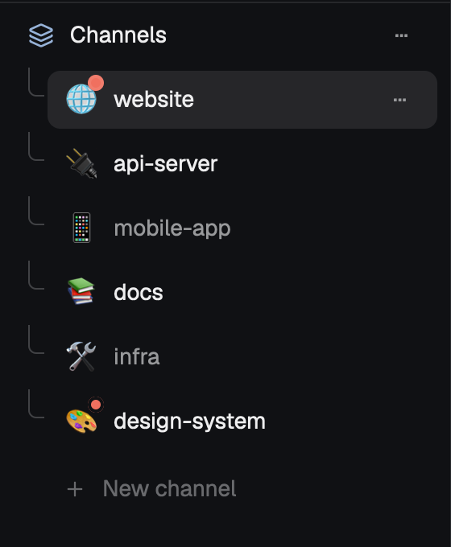

- **Chat.** Selecting a channel opens its chat in the main area. Ask the chat to start work and it
  creates a task with `channels start`, writing a brief that the task can follow on its own.
  If the chat ends (`/exit`, a crash, or herdr-core losing it in an update or restart), it starts
  again in a few seconds on the same session, so its history is kept. A chat that stops within
  15 seconds of starting isn't started again on its own: the main area says why, and **Retry** (or
  selecting the channel) tries again.
- **Tasks panel.** The button at the top right toggles the panel. It groups the channel's tasks into
  *Needs input*, *Working* and *Ready for review*. A dot marks a task that asked something you haven't
  seen since you last opened it; a task that finished tells the chat instead ([task events](#task-events)). Click a task to open it live. Press the left arrow
  on an empty prompt to return to the list. Each channel's panel keeps its place: switch to another
  channel and back, and it shows the task you had open (or the list, if you went back to it), even
  after Herdr restarts. **+** starts a new session in the projects folder. The
  check mark resolves a task: it is hidden from the panel, and the session is not stopped or deleted.
  A task's `···` menu (or a right-click on it), the pencil in an open task's header, or a click on
  its name there renames it. The rename reaches Claude Code itself, so `claude agents` shows the same
  name, and the task's copies and its cards above the chat take it too.

  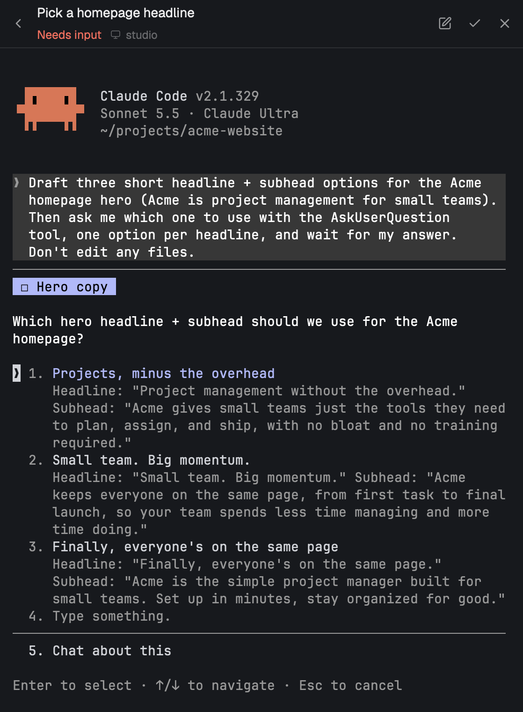

  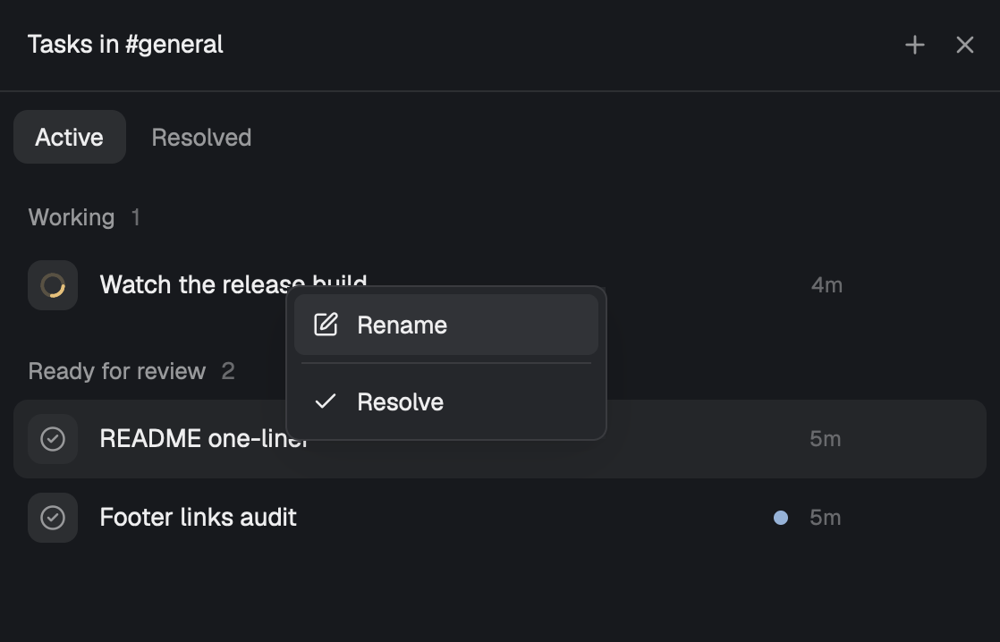

- **Spaces: plain Herdr.** Below the channels is Herdr's own **Spaces** list, the same one Herdr's
  own layout shows, for a shell, a plain Claude Code session or anything else Herdr runs. It works as
  it does in Herdr: click a space to show it, right-click it to rename or close it, drag to reorder,
  and **+** makes a new one. The `channels` space in it is where the chats live; clicking it goes
  back to the selected channel.

  While a space is shown, the window is plain Herdr: Herdr's own tab bar replaces the channel's bar,
  with its **+** menu (a terminal, Claude Code or another installed agent, or a new space) and its
  **Files** and **Changes** panels. The tasks panel folds away and comes back when you select a
  channel again. Herdr's keys work as usual, and picking a space with them (⌃1-9) shows it the same
  way.

  How Herdr's spaces work: a space is a place to work on one machine, holding tabs, and each tab holds
  terminals side by side. A new space starts where the space you were in is (else in that machine's
  home folder), and a space nobody named is called after the folder its first terminal is in now, so
  `cd` into a project and the space takes its name. Spaces keep running when you switch away, and
  Herdr's own layout (`layout.switch`) shows the same ones. A Claude Code session started in a space
  isn't a channel task; `channels file <channel> <session>` files it into a channel.

  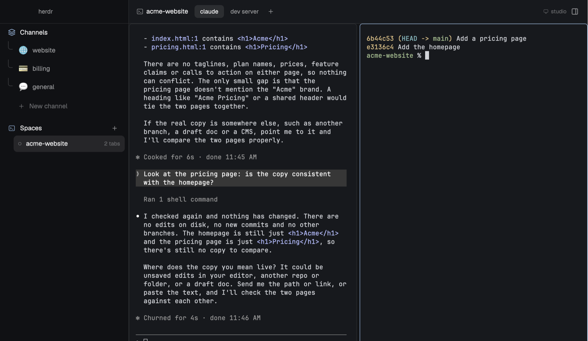

### Task events

The chat's tab runs `channels chat <channel>`. This starts the chat's Claude Code session and a small
listener alongside it. Every 3 seconds the listener reads Claude Code's records of the channel's
tasks (`~/.claude/jobs` and `~/.claude/sessions`). A task finishing, or stopping to ask a question
or show a permission prompt, is an *event*.

**Which events reach the chat: the notice gate.** Each notice costs the chat a turn, so a gate decides
first, on its own: it tells the chat what needs it, and keeps out the rest, including what you already
saw. Nothing is saved up for later. It goes in this order, and the first rule that matches wins:

| # | If | Then |
|---|---|---|
| 1 | The chat [registered](#registrations) for this event | It wakes the chat, whoever started the turn. |
| 2 | It's a permission prompt or a Codex approval | It gets its [card](#task-cards). It rides along with your next message only if the chat started that turn. |
| 3 | You started the turn yourself, by typing in the task's view | The panel only: you were there. |
| 4 | You had the task open in the panel when it ended | The panel only: you saw it. |
| 5 | You sent the turn from the panel (**Send message…**) | The panel only. |
| 6 | The chat's turn failed | It wakes the chat. |
| 7 | The chat's turn ended asking something | It wakes the chat ("needs you"), beside its card. |
| 8 | Your rules say otherwise (below) | The panel only, or it wakes the chat. |
| 9 | The chat's turn finished | A judge decides. |

Who started a turn: the chat asked for the task's first turn (`channels start`), and for each turn it
sends with `channels send` (a card's Send counts: the card is the chat's). The store keeps each ask
on the task, and the first turn end after it answers it. A turn with no ask before its end is one you
started. Say the task gives a long report and you type "rephrase that more concisely" in its view:
the chat hears about the report and never about the rephrasing. Codex and cloud tasks work the same way.
A task filed into a channel (`channels file`) or started empty from the panel has no ask until the
chat sends it something. The panel says which task is open with `channels viewing` (every minute while
it stays open).

**The judge.** An ordinary finish of a turn the chat asked for goes to a small `claude -p` call on
your own Claude sign-in (Sonnet by default; it takes a few seconds and costs about half a cent). It
gets the chat's ask, the task's report, the chat's last few messages and your rules for the channel,
and it answers *wake* (the goal is reached, a next step the chat planned can start, or a problem turned
up) or *skip* (polish, rephrasing, small follow-ups, "done, nothing notable", or what your rules say
to leave out). A skipped finish shows in the panel as ready for review, like any other; the chat never
hears of it, and `channels read <session>` has it if you ask the chat. The judge runs with no tools, no
MCP servers, no settings and no saved session, in an empty folder. Every text it reads goes in a marked
data block, and its answer is checked against a schema, so a task's report can't steer it into anything
but those two answers. When it can't answer, the finish is skipped. After three failures in a row it
rests for an hour, and so it does past 30 calls an hour in one channel. `CHANNELS_JUDGE=off` turns it
off (those finishes are skipped); `CHANNELS_JUDGE_MODEL` picks another model.

**Your rules** are optional. The channel menu's **Notifications** (or `channels notify <channel> --set -`)
holds plain-words rules, one per line, and you can also just tell the chat ("stop telling me about small
edits"): it updates them.

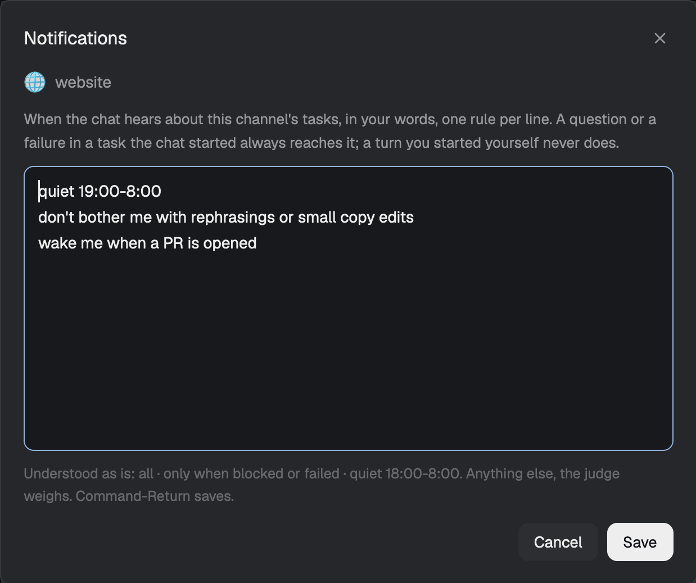

| Rule | Read by | What it does |
|---|---|---|
| `all` | the gate | Every finish of a turn the chat asked for wakes it, with no judge. |
| `only when blocked or failed` | the gate | Only failures and questions wake the chat. |
| `quiet 18:00-8:00` | the gate | In those hours, only failures and questions wake the chat. |
| `don't bother me with rephrasings or small edits` | the judge | Such finishes are skipped. |
| `wake me when a PR is opened` | the judge | A finish that opens a PR wakes the chat. |

**Why a task's event did or didn't reach the chat:** `channels why <session>` shows the gate's last
decisions on it. Every decision is also a line in `gate.jsonl` beside the store.
`docs/notice-gate-design.md` has the design and the research behind it.

**A task's finish that the gate lets through** reaches the chat as a one-line notice, the way a subagent's result reaches
the session that started it:

```
← tasks: Task "Draft the launch notes" (studio/f131909d-…) finished: Drafted NOTES.md with the launch…
⏺ The "Draft the launch notes" task is done: the checklist line is in acme-website/NOTES.md.
```

Claude Code holds the notice until the chat is idle, so it never cuts into an answer. Then the chat
takes a short turn: it says what matters in a line or two, ties it to what you were talking about
when it bears on it, and otherwise just acknowledges it. The task's full report stays in
`channels read <session>`. A finish gets no card and no dot; the task shows as ready for review in
the tasks panel.

The notice travels through a Claude Code channel (an MCP server that pushes messages into a session): `channels chat`
starts the chat with `--mcp-config` for `channels notices <channel id>`, a small MCP server that
pushes each queued notice. Claude Code loads a channel server of your own only with
`--dangerously-load-development-channels`, and asks to confirm that at every start; the chat's
listener answers it. The listener then checks the chat's transcript for each notice it pushed. One
that hasn't arrived a minute later, once the chat is idle (an older Claude Code, or an account where
an administrator keeps channels off), is typed into the chat as a `[task notice]` line instead.

**A task that ended a turn the chat asked for asking for something** (a question, or a hand-off such as "Task A is
done. Please start B and C") reaches the chat as a one-line notice too, through the same channel, once
per blocked turn:

```
← tasks: Task "Draft the launch notes" (studio/f131909d-…) needs you: Should the notes go in NOTES.md or the README?
```

What it asks is the task's question, or, when Claude Code recorded none, the end of its last message,
cut to the notice's length. The chat acts on the request only when it is what you already set up for
the channel (say, "when A is done, start B and C"); otherwise it puts it to you in a line or two. The
task also gets its dot in the panel and its [card](#task-cards) above the chat's prompt, where you can
answer it, and the question doesn't ride along with your next message too: the notice already told the
chat.

**A task that waits on a permission prompt** (or another dialog in its own session) is no notice: its
card answers it. It is delivered at one of three levels:

| Level | When | What happens |
|---|---|---|
| **panel** | Every prompt and question | The task gets a dot in the tasks panel until you open it there. |
| **ride-along** | The default for a prompt in a turn the chat asked for (one in a turn you started in the task's view shows only its card) | The chat takes no turn. The prompt shows as a [card](#task-cards) above the chat's prompt, and waits in the store to be attached to your next message in the chat as background context. The chat mentions it only if it's relevant or blocking, in one line. |
| **wake** | Only when a registration exists for that task | The listener pastes a `[task question]`, with the task's whole last message, into the chat's herdr terminal with `hc send`, which waits until you stop typing. This starts a turn, and the message says why it woke the chat. It takes the place of a question's notice. |

A cloud task can't be told apart this way: claude.ai's list says only that it waits on you
(`requires_action`), for a question or a permission prompt alike, so both are a notice beside the card.

Ride-along uses a Claude Code `UserPromptSubmit` hook. `channels chat` passes it to the chat with
`--settings`, so it applies to that session only and your own settings files are not touched. The
hook runs `channels pending <channel> --hook`, which prints the waiting events as additional
context and marks them delivered. A task's newer event replaces its older one while it waits.
A delivered question stays as a card until it is answered, dismissed or the task moves on, but
isn't attached again. A question nobody answers in two days goes too: a task that ended its turn
asking stays that way in Claude Code's records, so it would never move on by itself. The task
still waits in the tasks panel, and `channels send` still answers it.

<a id="registrations"></a>
A registration asks for the chat to be woken by a task's next matching event:

```
channels watch <session> --wake-on finish|question|any [--why <text>]
channels start <channel> --wake-on finish|question|any <brief | ->
channels send <session> --wake-on finish|question|any <text | ->
```

`question` matches a question or permission prompt, `finish` a task finishing, and `any` either.
A registration skips the gate: it also brings the finish (or question) of a turn you started in the
task's view, or one the judge would hold, and adds its `--why` to the notice.
A registration is used up when it fires; `--wake-on none` cancels one. `--why` is shown in the
wake message (for example, the words the user used to ask to be told). The chat registers when it
is waiting on a task's answer in order to report back, or when you ask it to tell you about a task.
A message `send` delivers to a copy of the task carries the registration to the copy.

An event identical to the last one recorded for its task is dropped at every level: no notice, no
dot, no ride-along, no wake, and a registration keeps waiting. That covers a task that did more work but
ended with the same final message, the same question asked again, and a task stopped while it
waited on a question (as `send` does). The store records what each task was last seen as, so
events that happen while the chat is closed are delivered when it next opens, and none arrives twice.

Anything typed into the chat starts a turn, so a prompt that another tool types into it on a
schedule is a wake by nature, and the waiting events ride along with it too.

To see what the listener would do right now, run `channels listen <channel> --once` (it records what
it does). `channels pending <channel>` shows what waits for the chat's next message without taking
it, and `channels seen <session>` clears a task's dot.

### Task cards

Every question and permission prompt also shows as a card in the chat, in the band directly above its
prompt. A finish has no card: it is a [notice](#task-events). Acting on a card never starts a turn of
the chat:

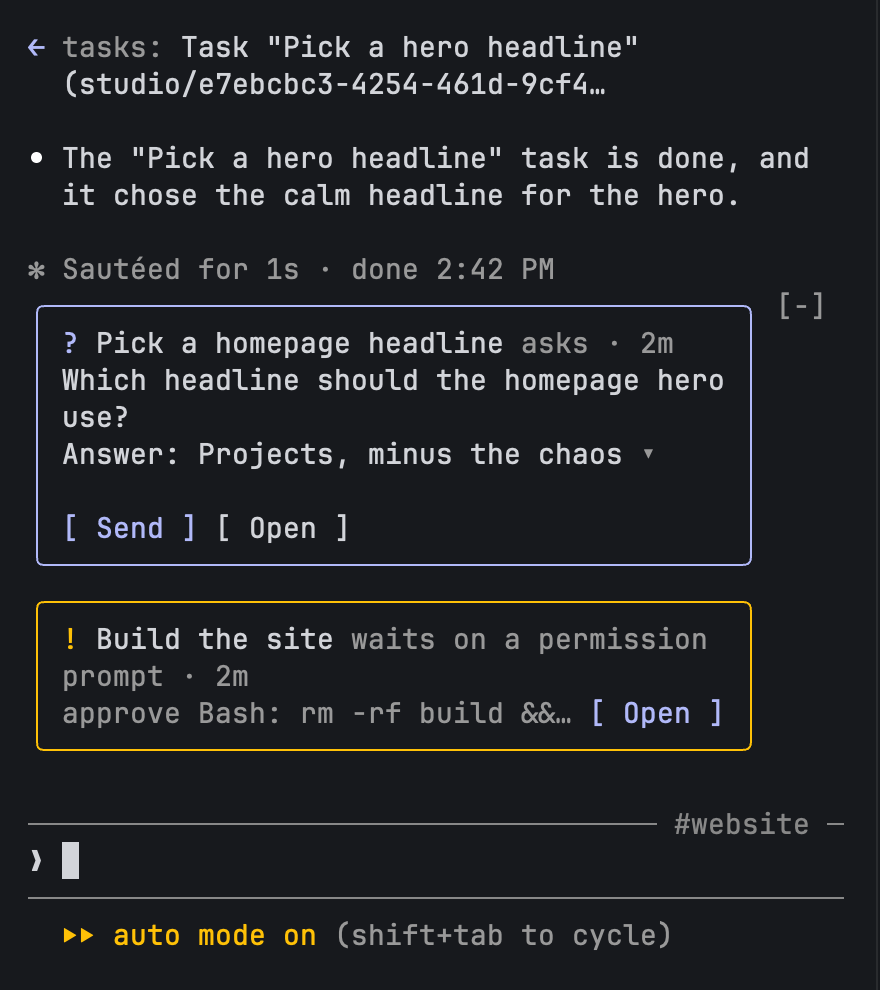

| Card | Shows | Buttons |
|---|---|---|
| **A task asks something** (it ended its turn with a question) | The task's name, *ended its turn asking you*, and its question. If the question ends with a short list of choices (`1. Teal`, `- Coral`), they are in a Select, with *Something else…* for your own words; otherwise there is a text field. | **Send** gives the task your answer (`channels send <session> -`), and it carries on. **Open** shows the task in the tasks panel, as clicking it there does. **Dismiss** takes the card away and leaves the task as it is. |
| **A task waits on a permission prompt** (or another dialog in its own session) | The task's name and what the prompt asks | **Open**, to answer it in the task's view. **Dismiss** |

Every card has **Dismiss** (`channels card dismiss <session>`). A button whose command fails says why
on the card, in red; **Open** that works says so in a toast.

To reach a card from the keyboard, press `ctrl+x tab` to focus the band, then a letter: on the top
card, `s` is **Send**, `o` **Open**, `d` **Dismiss**, `c` **Open on claude.ai**, and on a Codex
approval `y` **Allow** and `n` **Deny**. The top card's last line says which apply. On a question
with choices the focus starts on **Send**, so `enter` sends the answer shown. `tab` and
`shift+tab` move between the controls, the cards below the top one included, and `enter` presses
one; `esc` goes back to the prompt. On a question with a text field, the focus starts in the field:
type and press `enter` to send, or `tab` out of it to use the letters. On the Select, `enter` opens
it, the arrows pick, and `enter` again keeps the pick for **Send**:

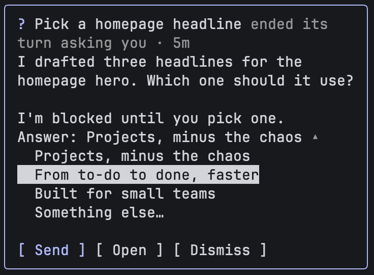

Clicking a card works only in Claude Code's fullscreen layout, the one that takes the whole terminal
and keeps the prompt at the bottom. On the main-screen ("classic") layout the band takes no clicks,
so use the keys there. `channels chat` asks for fullscreen in the chat's own settings (`tui`), but
Claude Code keeps the main screen when `CLAUDE_CODE_NO_FLICKER=0` or
`CLAUDE_CODE_DISABLE_ALTERNATE_SCREEN` is set, when `tui` is set in managed settings, for a screen
reader, or after a fullscreen start crashed on that Mac. `CLAUDE_CODE_DISABLE_MOUSE` and
`CLAUDE_CODE_DISABLE_MOUSE_CLICKS` turn clicks off even in fullscreen. To see which layout a chat
has, type `/tui` in it: it answers `Current renderer: fullscreen` or `classic`.

The cards can also be used from the prompt, with no click and no focus on the band, which works in
any layout and with any key bindings. Type `/cards` to list them, numbered from the top, with each
one's question and choices, then act on one by its number (the top card when it is left out):

```
/cards                      lists the cards
/cards send 2 Calm          answers card 2; a choice's number works too: /cards send 2 2
/cards open 1               shows the task in the tasks panel
/cards dismiss 1            takes the card away
/cards allow 1, deny 1      answers a Codex approval
/cards claude 1             opens the task on claude.ai
```

A lone number after `send` is the answer, so `/cards send 2` sends the top card its second choice.
`/cards` starts no turn of the chat.

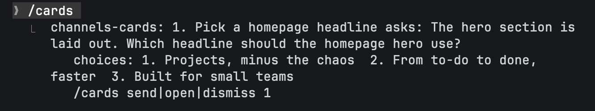

If `ctrl+x tab` does nothing (the band never shows a focused control), something before Claude Code
takes the keys: a `ctrl+x tab` or `abovePrompt:focus` entry in `~/.claude/keybindings.json`, or a
`ctrl-x` binding in Herdr's `~/.config/herdr-app/keys.json`. `/cards` works either way.

Acting on a card marks its event handled in the store: it leaves the chat's inbox and the task's dot
in the panel clears, so it doesn't also ride along with your next message. A prompt's card you don't
act on still rides along; a question's was told as a notice already; nothing is delivered twice. A question you answer in the task's own view goes
away by itself once the task works again. More than four cards are counted on one line, and the rest
ride along as usual. A registered wake (`--wake-on`, `channels watch`) still wakes the chat with a
turn and shows no card, since the chat is waiting on that answer.

The cards are a Claude Code mod in `mods/claude`. `channels chat` starts the chat's `claude` with
`--plugin-dir` pointing at the installed copy, so only channel chats load it: not tasks, and not
your other Claude Code sessions. Every two seconds it reads the store's `channels.json` and draws
the channel's waiting events; its buttons run `channels`:

```
channels send <session> -          Send
channels open <session>            Open: herdr's channels mod shows the task (herdr-app do channels.open-task)
```

## Remote Control

Remote Control is off unless you turn it on, and it is set per Mac. When it is on, each channel's chat and every
task `channels` starts also shows at [claude.ai/code](https://claude.ai/code) and in the Claude app on your phone,
where you can follow it, answer its questions and send it messages. The sessions keep running on the Mac; Remote
Control only lets claude.ai reach them.

**What turning it on means.** While a session is connected, its transcript (your messages, Claude's replies and
its tool activity, so code and command output too) goes through the claude.ai account this Mac's Claude Code is
signed in to, and is kept under that account's data policy. Anyone who can see that account's session list sees
the sessions' names. On a Team or Enterprise plan the organization has to allow Remote Control (an Owner turns it
on in the admin settings, under Claude Code), and the sessions show in the organization's list, not a personal one.
Remote Control needs a claude.ai sign-in (Pro, Max, Team or Enterprise): with an API key, Bedrock, Vertex or a
gateway, sessions start with it off. Nothing breaks either way: a task still runs.

**Check a Mac before turning it on**, the work laptop above all:

```sh
claude auth status                        # which account and organization this Mac uses
claude --bg --remote-control -n "rc check" "Reply with only ok."
grep bridgeSessionId ~/.claude/jobs/<job>/state.json   # present: allowed; absent: run /remote-control in a claude to see why
claude stop <job>
```

`<job>` is the id `claude --bg` prints after `backgrounded ·`. Then turn it on, or off again:

```sh
node ~/projects/herdr-channels/install.mjs --remote-control      # on
node ~/projects/herdr-channels/install.mjs --no-remote-control   # off
```

Pass the options you installed with as well (for example `--projects ~/code`). The setting lives in the
installed `channels` command (`CHANNELS_REMOTE_CONTROL=1`). Your own Claude Code settings are never changed:
`channels` passes the flags itself, to its own sessions only.

**What `channels` does when it is on:**

| Session | How | Name on claude.ai |
|---|---|---|
| A task (`channels start`) | `claude --bg --remote-control <task name> …` | The task's name |
| A channel's chat | `remoteControlAtStartup: true` in the settings the chat is started with, and `--remote-control <name>` | `#<channel> · <machine>`, since the account's list doesn't say which machine a session runs on (`CHANNELS_MACHINE`, else the host name) |
| The panel's **+** (new session) | `claude --bg --remote-control` | From its first message |
| `channels send` | Nothing: Claude Code resumes a background session with the options it started with, Remote Control included. A flag on a resume would start a copy instead | Unchanged |

A chat that is already running takes the change when it starts again: type `/exit` in it, and it starts again
on the same session within seconds. Tasks keep what they started with: turning it on doesn't reach tasks
already running, and turning it off doesn't disconnect them (stop them, or let them finish).

**Copies.** When Claude Code starts a copy of a task instead of continuing it (see `channels send`), the copy
gets only the options of the command that made it, and `send` passes none. So a copy isn't on claude.ai, unless
Remote Control is on for all sessions in Claude Code's own settings (`/config`, "Enable Remote Control for all
sessions"). `send` says so when it files a copy.

**The claude.ai link.** Each session with Remote Control has a link of its own, the same across `send` and a
chat's restart. `channels` reads it from Claude Code's records (the job's `state.json`, the running process's
record in `~/.claude/sessions`, or the transcript). With a link, a task gets **Open on claude.ai** in its `···`
menu, a button in its header when it is open in the panel, and a button on its card above the chat's prompt. Each
opens the link in your browser with macOS `open`. `channels link <session>` prints it, `--open` opens it, and
`channels read` shows it on its first lines.

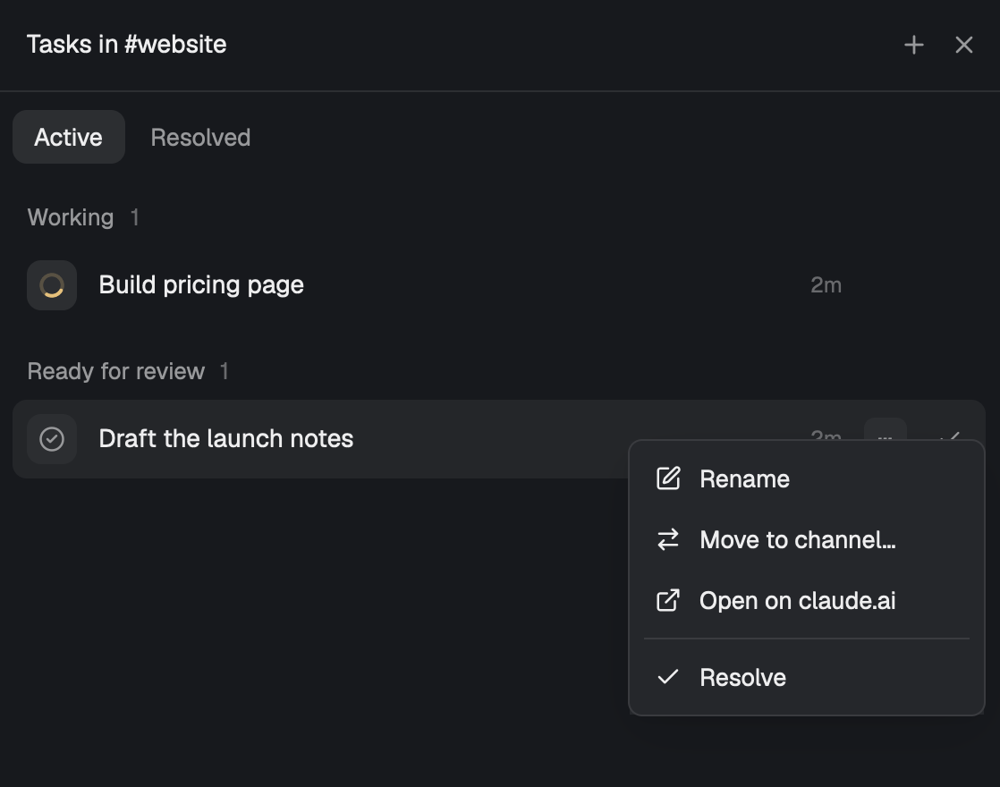

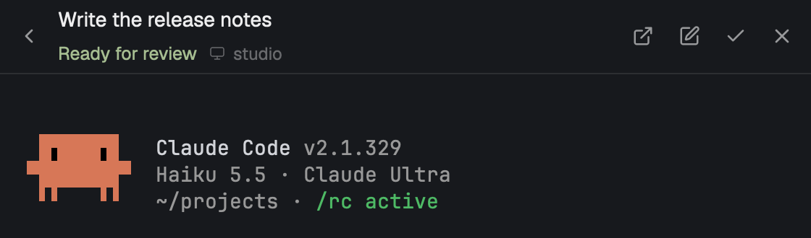

**Renaming.** `channels rename-task` (and Rename in the panel) renames the task in Claude Code's job record, which
is how `claude agents` renames a session. Claude Code passes that name on to claude.ai, so the title there
follows, and keeps it when the task is resumed.

**Ending sessions.** A session that ends cleanly (it is stopped, or `/exit`) leaves the claude.ai list within
seconds. One whose process dies without a clean stop (a crash, `kill -9`) stays listed as idle until it is
resumed and stopped, or archived on claude.ai. A Mac that sleeps shows its sessions as idle or offline until it
wakes; messages sent from the phone meanwhile wait.

## Cloud tasks

Cloud tasks are off unless you turn them on, and they are set per Mac. When they are on, a channel can run a task
as a Claude Code cloud session at [claude.ai/code](https://claude.ai/code) ("Claude Code on the web") instead of on
this Mac, and track it beside its local tasks: in the tasks panel, on cards above the chat's prompt, and in the
events the chat hears about. The Mac can sleep while a cloud task works.

**Read this before turning them on, the work laptop above all.** Cloud tasks ride on Claude Code's **private API**,
and they **read Claude Code's stored claude.ai login**:

- Starting and messaging a cloud session use Claude Code's own CLI (`claude --cloud`, `claude -p --cloud`). But no
  supported command lists cloud sessions with their state, so `channels` calls the same undocumented endpoint
  Claude Code itself uses (`GET https://api.anthropic.com/v1/code/sessions`). It can change or go away without
  notice. When it fails, a cloud task shows **state unknown** and keeps **Open on claude.ai**; nothing else breaks.
- To call it, `channels` reads the claude.ai login Claude Code keeps: on macOS the login Keychain item
  `Claude Code-credentials`, on Linux `~/.claude/.credentials.json`. It reads it fresh for each call (Claude Code
  refreshes it), and never prints, logs or stores it. All of this lives in one file, `bin/cloud.mjs`.
- A company Claude organization may turn cloud sessions off (`Cloud sessions are disabled by your organization's
  policy`), and a managed Mac may forbid other programs from reading Claude Code's Keychain item, or prompt for it.
  Either is a reason to leave cloud tasks off there. Ask first.
- A cloud session works on a fresh clone of the repo's GitHub copy, under the claude.ai account's GitHub access
  (the Claude GitHub App, or the `gh` login saved with `/web-setup`), and shares that account's rate limits.

Claude Code's own settings and rollout flags are never touched. To turn cloud tasks on, or off again:

```sh
node ~/projects/herdr-channels/install.mjs --cloud      # on
node ~/projects/herdr-channels/install.mjs --no-cloud   # off
```

Pass the options you installed with as well (for example `--projects ~/code`). The setting lives in the installed
`channels` command (`CHANNELS_CLOUD=1`). A chat that is already running takes the change when it starts again:
type `/exit` in it. With cloud tasks off, nothing calls the API or reads the login; cloud tasks filed earlier stay
listed, as state unknown.

**Starting one.** Ask the chat for a cloud task, or run:

```sh
channels start <channel> --cloud --repo <project> [--name <name>] [--wake-on finish|question|any] "<brief>"
```

The repo must be committed and pushed: the session starts from GitHub, so `start` refuses a tree with changes,
a branch that isn't on the remote, or commits that aren't pushed ("push first"). It then runs `claude --cloud
"<brief>" -n <name>` under a pty in the repo, reads the session's id and link from what it prints, and files the
task as `cloud/<session id>`. `--model` doesn't apply: the cloud environment picks the model. `channels file
<channel> <session_… | cse_… | claude.ai/code link>` adopts a cloud session started elsewhere (the phone,
claude.ai, another Mac).

**Tracking.** While a channel has an open cloud task, its listener asks for the account's session list every
20 seconds: one call covers every session and every channel, and uses no model. A session that is running shows
as Working, one waiting on you (`requires_action`) as Needs input, one whose turn ended as Ready for review. The
row has a cloud glyph and the session's cost so far. Each change is an event, as for a local task: a finish of a turn the chat asked for is a
one-line notice in the chat (one you started on claude.ai or the phone tells the chat nothing, as a turn typed in
a local task's view); so is a question (`Cloud task "…" needs you: …`), with a dot in the panel and a card
above the chat's prompt, or a wake when the chat registered for it. A finish's text is claude.ai's one-line summary of the turn; the whole session is on claude.ai. After a 401
(Claude Code hasn't refreshed the login yet) it waits a minute; any other failure shows state unknown until a
call works again.

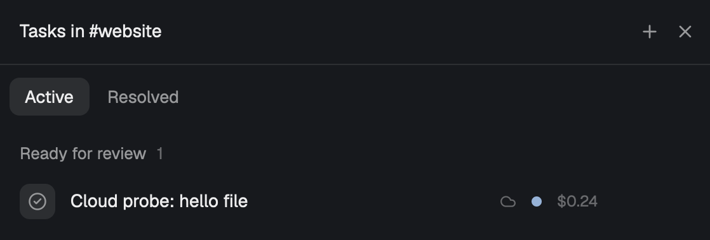

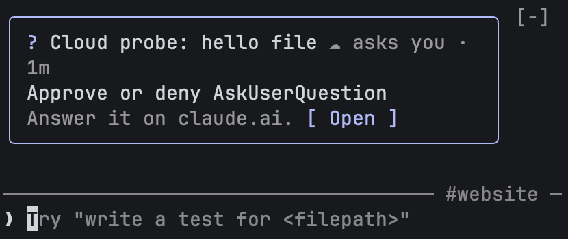

| | Local task | Cloud task |
|---|---|---|
| Open (click the row) | Its live session in the panel | On claude.ai in the browser. In the panel with `claude --cloud <id>` only once Claude Code can attach a terminal for the account, which `channels` asks Claude Code now and then |
| Its question, on a card | Answer (Select or field), Send, Open, Dismiss | What it asks, **Open**: answer it on claude.ai, and Dismiss |
| Send | `channels send`, or type in its view | `channels send`, or **Send message…** in its `···` menu. Behind an open question the text waits until the question is answered on claude.ai, and both say so |
| Rename | In Claude Code too | Here only: Claude Code has no supported way to rename a cloud session from outside, so claude.ai keeps its title (and a title changed on claude.ai shows here, until you rename it here) |
| Resolve / dismiss | Hides the task | Hides the task. The session keeps running and stays on claude.ai: archive it there (`···` → Archive). There is no command for that |

`channels read cloud/<id>` shows its state, summary, cost and link; `channels link cloud/<id> --open` opens it.

## Codex tasks

A task can run on OpenAI's [Codex CLI](https://github.com/openai/codex) instead of Claude Code, and so can a
channel's chat ([A Codex chat](#a-codex-chat)). Claude Code stays the default for both: a Codex task is started,
followed, answered and reported on from the same chat, panel and cards as any other.

**Requirements.** `codex` installed and signed in (`codex login`). The installer turns Codex tasks on when it finds
`codex` (`--no-codex` turns them off; `node install.mjs --codex` turns them on later). Off, nothing calls Codex.

**Starting one.**

- Ask the chat: "have Codex do it". It starts the task with `--harness codex` and says which harness it used.
- `channels start <channel> --harness codex [--repo <project>] [--name <name>] <brief | ->`.
- A channel's default: the channel's ··· menu, **Tasks run on**, or `channels harness <channel> --tasks codex`. Its
  tasks then start on Codex unless one asks for Claude Code (`--harness claude`, or "use Claude Code for this").
- The tasks panel's **+** becomes a menu, **New Claude Code session** or **New Codex session**. A new Codex session
  is an empty thread opened in the panel, where you type its first message.

**Where it runs.** In Codex's own background service: the app-server daemon that Codex's own terminal app starts and
uses. So a Codex task is an ordinary Codex session: `codex resume` lists it, and when Codex's remote control is on
(`codex remote-control start`, paired with the Codex app), it shows in the Codex app on your phone like any session
you started, **with its name and brief**. When the service can't be reached, the task runs in a herdr-core terminal
of its own instead ("in a terminal" in its header); then it can't be renamed from outside and its prompts are
answered in that terminal.

**What it gets.** Its brief; the repo's `AGENTS.md`, or its `CLAUDE.md` when it has no `AGENTS.md`; and one rule:
when it can't go on without you, end with the question as its own last line. Codex has no "I'm asking" signal in
its default mode, so that last line is how channels tells a question from a finish. It runs with Codex's default
permissions: the `workspace-write` sandbox, asking before it leaves it (the network, files outside the repo).
`--permission-mode` picks another: `plan` (read-only), `auto` (Codex's automatic reviewer answers approvals) or
`bypassPermissions` (no sandbox, no approvals).

**Following it.** Everything in [Task events](#task-events) holds: a finish, or a question, reaches the chat as a
one-line notice; a question is a card you can answer; the unread dot and Tell chat work as before. A Codex task's
row in the panel has a small mark when the channel has tasks on both harnesses, and its header names the harness
and its sandbox. Opening it runs `codex resume` in the panel: you watch and type into the live session, mid-turn too;
leaving it leaves the task running.

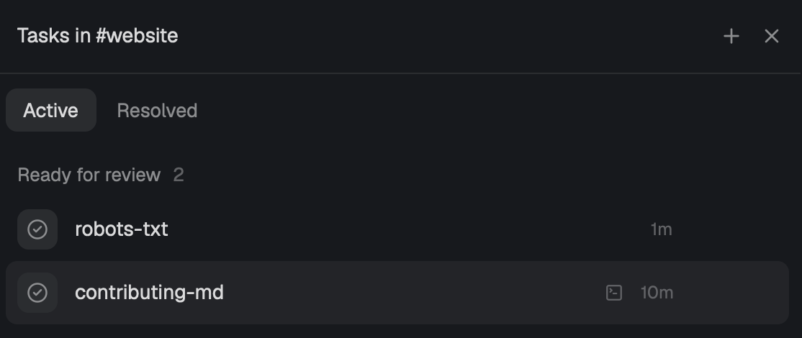

**Approvals from a card.** When a Codex task asks to run a command (or change files) outside its sandbox, its card
shows what it would run and why, with **Allow** and **Deny**. Either answers it in Codex's service, the task goes on,
and its own view in the panel clears the prompt by itself. `channels approve <session> allow|deny` does the same.
Claude Code tasks' permission prompts still offer Open only.

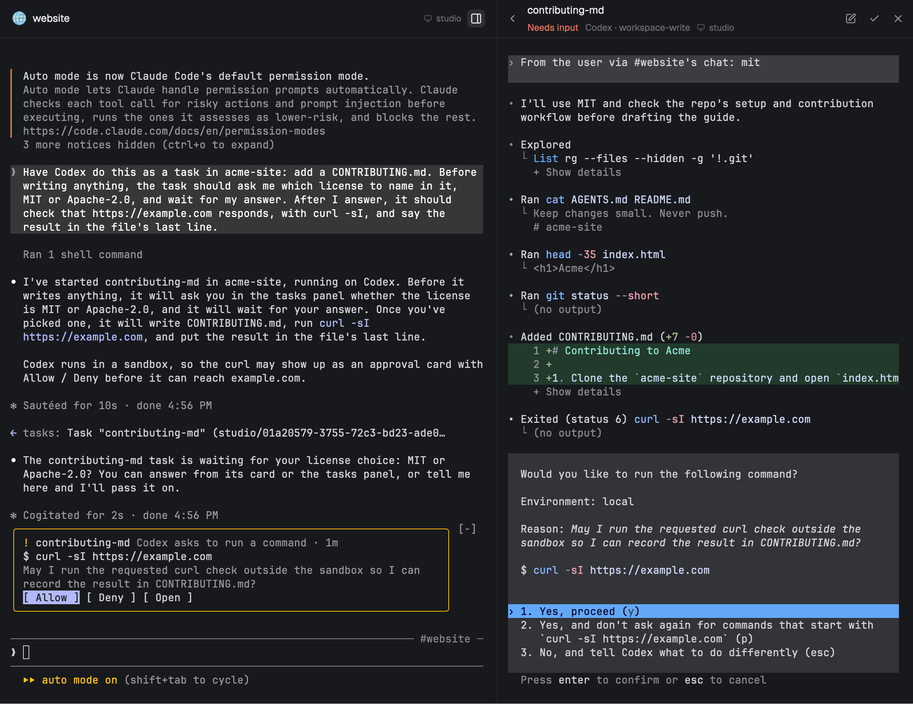

**Messages.** `channels send` (or a card's Answer) to a Codex task whose turn is over starts its next turn, also
long after, when Codex has unloaded it. To one still working, the message is **queued** to run after its turn,
rather than refused as for Claude Code, and channels doesn't report the task finished while a queued message waits.
Renaming a Codex task renames it in Codex too.

**What Codex tasks don't have.** Remote Control's claude.ai link, cloud tasks, and copies (Codex never starts one).
Those menu items and buttons hide for a Codex task. channels adds no hooks to a Codex task, and never answers
Codex's folder-trust question: a new Codex session opens in the projects folder, which you trust once by running
`codex` there. Codex tasks through a store on another machine are later work ([docs/harnesses.md](docs/harnesses.md)).

### A Codex chat

A channel's chat can run on Codex too: the channel's ··· menu, **Chat runs on**, or
`channels harness <channel> --chat codex`. The chat restarts on Codex once it is idle with an empty prompt, as a new
Codex session named `#<channel>`; the Claude Code session is kept, and switching back resumes it. The chat pane then
shows Codex's own terminal app, and what you type there is an ordinary Codex session in your Codex history
(`codex resume` lists it).

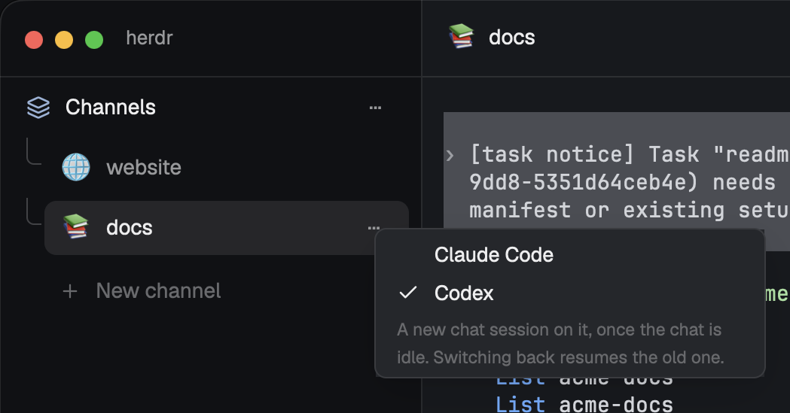

![The docs channel's chat running on Codex: a message opening with [task notice] says the readme-getting-started task needs you and asks where the docs site's setup instructions are; the chat looks in the repo and asks the user, the user answers with npm install then npm run dev, and the chat sends that to the task with channels send; the tasks panel shows readme-getting-started ready for review](docs/codex-chat.png)

**How it runs.** The chat has a Codex server of its own (`codex app-server` on a socket in the channels store), with
the chat's prompt and channels' hook given as settings for that server only: your Codex config files are left alone.
Codex's terminal app attaches to it, and the channels listener is another client of it, so nothing is typed into
the chat:

- A task notice (whatever the [notice gate](#task-events) lets through: a turn the chat asked for that failed, one the
  judge finds moves something, a task that needs you) starts a turn as a message opening with `[task notice]`. While
  the chat is answering, it waits in Codex's own queue and runs right after, so it never interrupts a turn or lands in
  something you are typing. It shows as a message rather than Claude Code's faded one-line event, followed by the
  chat's short reply.
- Routine runs go in the same way, queued behind any turn in progress.
- Ride-along news (a task waiting on you in a turn the chat asked for) comes with your next message, through the
  same `UserPromptSubmit` hook a Claude Code chat has.

**The hook's trust, answered for you.** Codex asks you to review a hook that is new or changed before it runs it
("Hooks need review"). The first time a Codex chat starts, the listener answers that prompt itself with **Trust all
and continue**. That also trusts any other new or changed hook you have in Codex at that moment. Codex remembers the
trust (in your `~/.codex/config.toml`) for the hook's command, which is the same for every chat, so it asks once per
Mac. Until the hook is trusted (say you chose "Continue without trusting"), ride-along news goes into the chat as
context its next turn sees.

**Running `channels`.** The chat runs with Codex's default permissions (the `workspace-write` sandbox), and
`channels` works outside that folder, in the channels store and the sessions it starts, so each `channels` command
asks to leave the sandbox. Codex's automatic reviewer answers those requests for the chat (as `--permission-mode
auto` does for a task); anything it finds risky still asks you.

**No task cards.** Task cards and `/cards` come from a Claude Code mod, and Codex has no surface above its prompt for
them. In a Codex chat, a task that waits on you shows in the tasks panel (its row, its unread dot, and the red dot on
the channel's icon in the sidebar), where you open it and answer it in its own view. A question in a turn the chat
asked for still reaches the chat as a notice; a prompt or an approval rides along with your next message. Tell the
chat what to answer, and it uses `channels send` or `channels approve`.

**Refresh.** Refresh and Refresh all chats restart a Codex chat as they do a Claude Code one: only when its thread is
idle and its prompt is empty, on the same thread. The Refresh button also restarts a Codex chat that runs an older
Codex than the one installed now.

**What a Codex chat doesn't have.** Task cards (above), Remote Control's claude.ai link for the chat, and the chat
in the Codex phone app: its server is the chat's own, not the shared Codex service that the phone pairs with.

## Routines

A routine is a prompt that a channel's chat receives on its own, on a schedule: "every weekday at 9,
ask me for my plan". It belongs to one channel and has a name, a prompt, a schedule, a catch-up
window and an on/off switch. The store keeps each routine with a record of its last run.

**Setting one up.** Open **Routines** from the channel's `···` menu, or click the small clock next
to a channel's name (hovering it shows the channel's next run). The dialog lists the channel's
routines with their next and last runs. With none yet, it offers three starters (a morning plan, a
weekly review, an end-of-day check) that open the editor filled in. You can add, edit or delete a routine, switch it on or off,
and **Run now** queues its prompt for the chat at once without changing the schedule (on a routine
that is off, the button says **Run once**). Its row says **Queued for the chat…** until the chat has
it, then **Running** until the chat reports how it went, then **Done** with the time and its note. Switching a routine off drops a scheduled run of it that was
still waiting for the chat; a run you asked for with Run now stays. Each row says where the routine
stands, in the same words as `channels routine list`: **Waiting 14 min: the chat's terminal didn't
take it** when a run can't reach the chat yet, **Skipped 09:00: this Mac was asleep until 11:40
(catch-up 1 hour)** for a run that came too late, **Off since Mon · switched off by you**. The
small clock in the sidebar turns red while a routine is failing or overdue (or its schedule doesn't
read) and amber after one bad run or while a run is stuck waiting; hovering it says which. You can also ask the chat
("every weekday at 9, ask me for my plan"): it sets the routine up with `channels routine add`.
A request no schedule fits ("every 90 minutes") gets the nearest one that does, and the chat says
what it chose. Something once ("remind me at 3 tomorrow") becomes a routine on that date that
removes itself when it runs. When it rounded a schedule or isn't sure what you meant, the chat
first proposes the routine with `--dry-run`, which runs every check and prints what it would set
up without saving. Either way it passes on the block the command prints:

```
Added a routine to #general:
  Routine:   morning-plan in #general
  When:      Weekdays at 09:00, this Mac's time
  Status:    on
  Next runs: Mon Nov 23, 09:00 and Tue Nov 24, 09:00
  Catch-up:  runs up to 1 hour late if this Mac was asleep or off at the time
  Prompt:    "Ask me for my plan for today."
  To change: ask in #general's chat, or open Routines in #general's menu (channels routine edit general morning-plan …)
```

Ask the chat why a routine didn't run and it reads `channels routine list --json` and
`channels routine runs --json`: whether the routine was off, and how each run went, and when.

**Run history and health.** Every run is recorded in the channel's run ledger (`runs` in
`channels.json`): when it was due, queued, delivered and over, how late it was, what started it (the
schedule or Run now, and who asked), its outcome, the chat's one-line note and the tasks it started.
A run's message ends by asking the chat to report back when it's done (or has started the tasks that
will do it): `channels routine report <channel> <run-id> ok --note "<one line>"`, or `failed --note
"<why>"`. A task the chat starts for a run with `channels start … --run <run-id>` is listed on it.
The outcome is one of:

| Outcome | Means |
|---|---|
| ok, failed | the chat reported it (a late report on a run that had counted as no report is taken, and marked late) |
| no report | the chat said nothing within the routine's grace time (30 minutes unless `--grace` says otherwise); with tasks tied to it, the run waits for them (up to 12 hours) and takes their outcome instead |
| undelivered | it couldn't reach the chat within the grace time (the error says why); it is still typed in when the chat can take it |
| missed | it came due while the Mac was asleep or off, outside its catch-up window |
| cancelled | it was waiting when the routine was switched off or deleted |

Each tick checks the open runs. When the gap since the last tick is over 5 minutes, the Mac slept,
and every open run's deadline moves on by the gap, so sleep never turns a run into "no report". The
newest 30 runs of each routine are kept, including a deleted routine's (shown as deleted).

From the ledger each routine gets a health, shown as a chip in the Routines dialog: **Failing** when
its last two finished runs (`--fail-after`) went badly (failed, no report, undelivered or missed), with
how many in a row and since when; **Overdue** when a time it was due passed over 3 minutes ago with
no run, so the timer didn't fire; **Running** while the chat has a run and hasn't reported. Otherwise
the row says how the last run went: **Done 09:00 · 2 min: Nothing needs you**. Click a routine to
open its **History**: each run's due time, outcome, how long it took, what the chat said (hover for
all of it), and the tasks it started (click one to open it). `channels routine runs` prints the same,
newest first, and `--json` gives the records. Switching a routine off can say why, `routine off
<channel> <name> --note "On holiday until Dec 2"` (the chat passes your reason on), and the dialog shows
the note until the routine is switched on again.

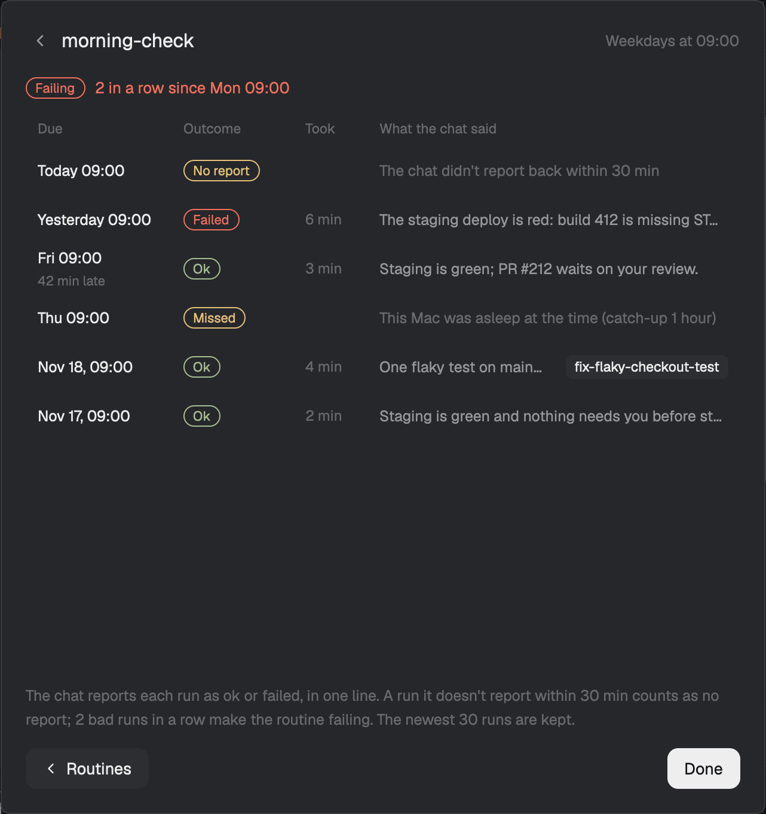
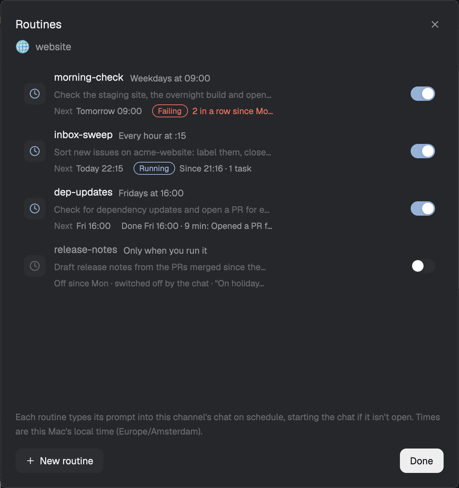

In the editor, the name fills itself from the prompt's first words until you type one. A problem
shows under the field it is about, and Create stays dimmed with the reason (Needs a name, Needs a
prompt, Fix the schedule) until the form is good. The line at the bottom says the schedule in words,
its next runs, what the catch-up window means for the next one ("If the Mac sleeps through 09:00, it
runs on wake until 10:00, else it's skipped") and the time zone.

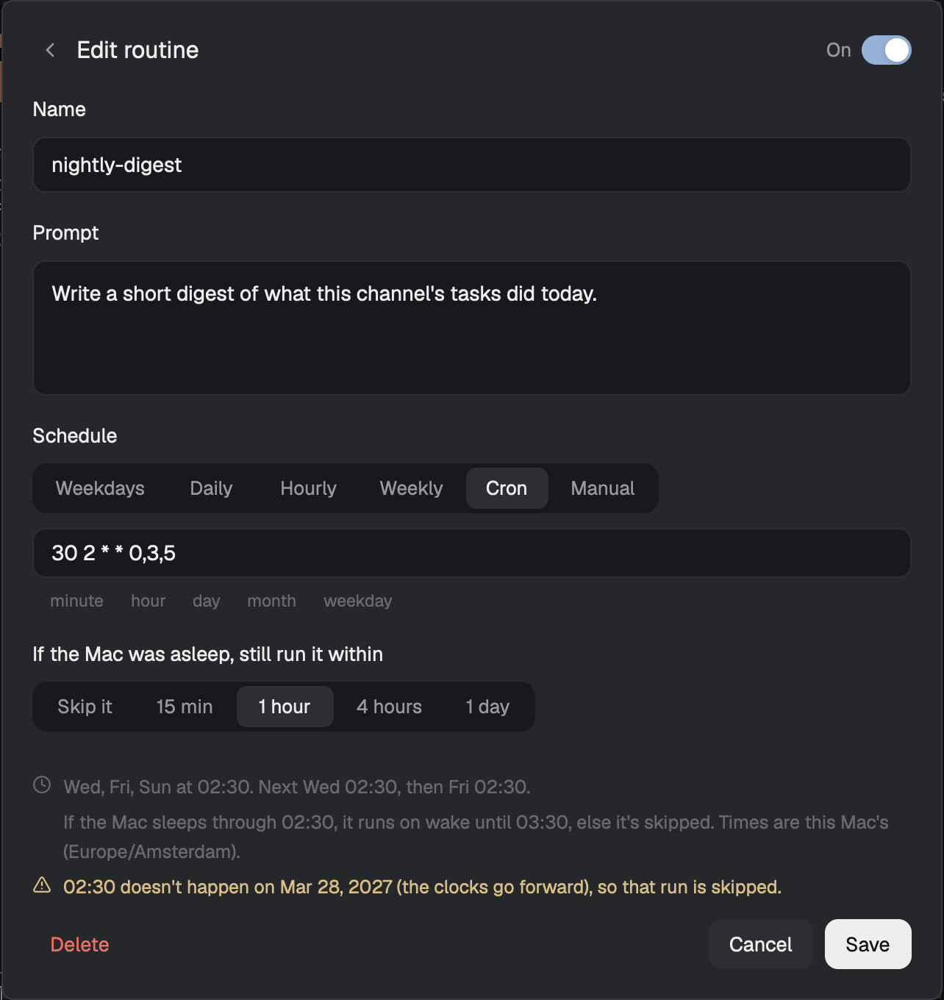

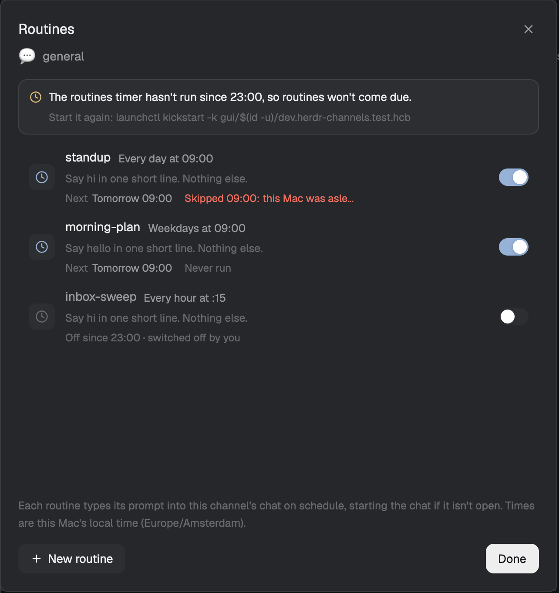
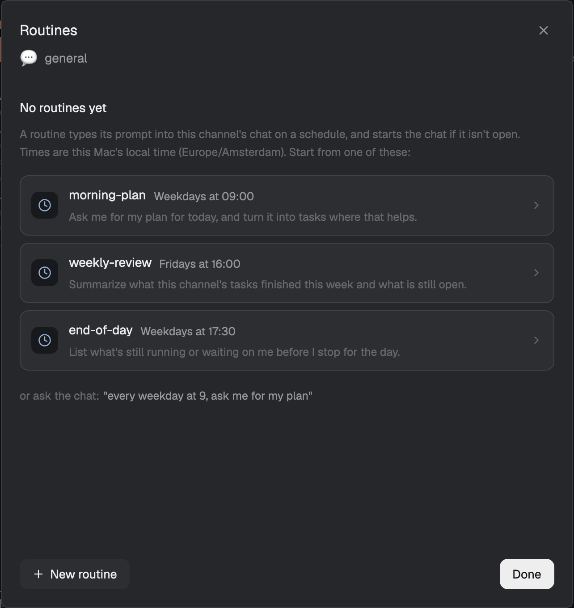

**Schedules** use the Mac's local time:

| Schedule | Runs |
|---|---|
| `weekdays 09:00` | Monday to Friday at 09:00 |
| `daily 18:30` | Every day at 18:30 |
| `hourly :15` | Every hour at a quarter past |
| `weekly fri 16:00` | Fridays at 16:00 |
| `cron 0 9 * * 1-5` | A standard 5-field cron line (minute, hour, day, month, weekday) |
| `manual` | Never on its own: only when you press Run now (or run `channels routine run`) |

Times may also be written `9`, `9:30` or `9am`. A cron line reads in words where it has a common
shape (`Mon, Wed, Fri at 09:00`, `Every 30 minutes`, `The 1st of each month at 09:00`), and as
`Cron 0 9 * 1 *` where it doesn't. When a schedule uses a time that doesn't exist on the night the
clocks go forward (02:30 in most of the US and Europe), the editor warns that that run is skipped.

**When a routine fires**, its prompt is typed into the channel's chat by the chat's listener, the
way a task report the chat registered for is (`hc send`, which waits while you are typing), as a
message that starts with `[routine <name> · scheduled 09:00 · run <id>]`. The run id is the routine
and the time it was due for (`rt_…@2026-11-23T08:00:00.000Z`, or `@manual-<time>` for Run now), so a
run is queued once however often its time is looked at. The message is made when it is typed in, so
it says how late it really is, and whether this is the routine's first run or its last one was
missed. It wakes the chat: it doesn't wait for your next message. The message ends with what the
chat's reply should be: one plain line with the outcome first (when there is nothing for you, that line is the whole reply), any limits the prompt
sets on days or times checked against the actual weekday and time, which the message states, and a
question only when the chat can't go on without one.

**If the chat isn't running**, the routine starts it in the background: the same chat session, so
its history is kept, in a herdr-core terminal named `chat-<channel id>`. Selecting the channel in
the sidebar then shows that terminal instead of starting a second chat. The mod opens every chat
this way, through `channels chat <channel> --bg`. Running `channels chat <channel>` in another
terminal while the chat runs attaches to it.

**Missed runs.** If the Mac was asleep or off at a routine's time, the run fires once when the Mac
wakes, as long as it is still within the routine's catch-up window (`0`, **Skip it** in the
dialog, means never run late). Without one, a new routine gets a window that suits its schedule:
15 minutes when it runs several times a day, so a late run can't land almost on the next one; an
hour for a daily one; 4 hours for one a week or rarer. Its message then says so: `[routine <name> · scheduled 09:00, running 10:40 · run <id>]`.
Missed runs never stack: after a long sleep only the latest missed time counts. A run outside the
window is skipped and recorded as missed. Nor do runs pile up behind a busy chat: when a routine's
time comes while its last run still waits for the chat, that time is skipped and recorded as
skipped (`routine list` and the dialog show it).

**The timer** is the launchd user agent the installer adds. It runs `channels tick` every minute,
and once when the Mac wakes. Each tick records every run that is due in the store before anything is
sent, under the store's lock, so two ticks at once can never fire a routine twice. It then queues the
prompt for the chat, and the chat's listener types it in. What the tick does is logged in `tick.log`
in the store, and each tick leaves its heartbeat in `tick.json` (when, on what version, what it did).
When that is more than 5 minutes old, the Routines dialog and `channels routine list` say the timer
hasn't run since then, with the command that starts it again. Check that the timer is loaded with
`launchctl print gui/$(id -u)/dev.herdr-channels.tick`.

`--by` on `routine run`, `on` and `off` records who asked (`dialog`, `chat`, `cli`, or `you`): a
run's message says who asked for it, and a routine that is off says who switched it off.

```sh
channels routine add general morning-plan --schedule "weekdays 09:00" "Ask me for my plan for today."
channels routine add general standup --schedule "weekdays 09:30" --dry-run "Ask me for my plan."
channels routine list
channels routine run general morning-plan --by cli
```

## Command reference

```
channels [list [<channel>]] [--all] [--json]
channels create <name> [--icon <text>] [--description <text>]
channels archive <name>
channels move <channel> <position>
channels rename <channel> <new-name>
channels icon <channel> <text>
channels describe <name> [--set <text> | --set -]
channels chat <channel>
channels start <channel> [--repo <project>] [--name <name>] [--model <model>] [--permission-mode <mode>] [--wake-on <on>] <brief | ->
channels start <channel> --cloud --repo <project> [--name <name>] [--wake-on <on>] <brief | ->
channels start <channel> --harness codex [--empty] [--repo <project>] [--name <name>] [--model <model>] [--permission-mode <mode>] [--wake-on <on>] <brief | ->
channels harness <channel> [--tasks claude|codex] [--chat claude|codex]
channels approve <session> allow|deny
channels file <channel> <session> [--harness claude|codex] [--name <name>] [--folder <path>]
channels read <session> [--limit <n>] [--json]
channels send <session> [--wake-on <on>] <text | ->
channels watch <session> --wake-on finish|question|any|none [--why <text>]
channels seen <session>
channels viewing <session> | --none
channels notify <channel> [--set <text> | --set -] [--json]
channels why <session>
channels link <session> [--open] [--json]
channels rename-task <session> <new-name>
channels dismiss <session> [--by <who>]
channels listen <channel> --once
channels pending <channel> [--hook]
channels card dismiss|tell <session>
channels notices <channel id>
channels open <session>
channels chat <channel> --bg [--json]
channels routine list [<channel>] [--json]
channels routine add <channel> <name> --schedule <schedule> [--catchup <window>] [--grace <time>] [--fail-after <n>] [--off] [--dry-run] <prompt | ->
channels routine edit <channel> <name> [--schedule <schedule>] [--catchup <window>] [--grace <time>] [--fail-after <n>] [--prompt <text | ->] [--rename <new-name>] [--on | --off] [--note <why>] [--dry-run]
channels routine rm <channel> <name>
channels routine run|on|off <channel> <name> [--by <who>] [--note <why>]
channels routine runs <channel> [<name>] [--limit <n>] [--json]
channels routine report <channel> <run-id> ok|failed [--note <text | ->]
channels routine preview <schedule> [--json]
channels refresh [--auto] [--all] [--json]
channels update [--check] [--bg] [--json]
channels tick
```

A catch-up window is a number of minutes or a length such as `15m`, `2h` or `1d`; a grace time is
minutes or `15m`, `2h` (up to 12 hours), and `0` means a run is done once it is delivered.
`channels start … --run <run-id>` ties the new task to a routine run (see [Routines](#routines)). `channels chat
<channel> --bg` makes sure the chat runs in its herdr-core terminal and prints that terminal.
`channels routine preview` shows a schedule in words with its next three runs, or what is wrong
with it.

`channels refresh` restarts the idle chats that run an older herdr-channels build or an older Claude
Code than is installed, on the same session, and says what it did; a chat in the middle of a turn is
restarted when the turn ends. With `--auto`, as the installer runs it, only chats behind
the herdr-channels build are restarted. With `--all`, every running chat restarts the same way,
whether or not it is behind: a chat that started before the request is behind on `restart` until it
has. `channels list --json` reports what each running chat is behind on, under `updates`.

`channels update` installs the latest herdr-channels release (see [Updating](#updating)); `--check`
only asks GitHub for it, and `--bg` runs the update in a process of its own, as the sidebar's Update
button does. `channels list --json` reports the installed version and the latest release under
`updates.release`.

`channels send` can only reach a background task that has finished its turn. It stops the idle
session, waits for its process to exit, and resumes the same session with the message. If the
process is still running after 30 seconds (`CHANNELS_STOP_WAIT_MS`), the command fails and starts
nothing. If Claude Code starts a copy of the session instead of continuing it, `send` says so, gives
the copy's session id, and files the copy into the original task's channel in its place; the original
task is marked as superseded by the copy and resolved. Sending to a task that is still working, or
is showing a permission prompt, fails; answer prompts in the task's view instead.

A task whose turn is over while a background task it started (a subagent, a background command)
still runs isn't stopped, since that would stop the background work. Claude Code still calls such a
session busy; `channels read` shows it as `waiting_on_job`, and `send` types the message into the
task's view, as you would in the panel: its `claude attach` runs for a moment in a herdr-core
terminal, the message is pasted into its prompt and sent, and the terminal is closed. The task takes
it as its next turn and the background work goes on. If a draft is typed in the task's prompt,
`send` leaves it alone and fails. Where herdr-core can't open the view, `send` fails and says that
the turn is over but a background task is still running: run `channels watch <session> --wake-on any`
and send once that wakes the chat.

`channels rename-task` renames a task the way Claude Code's own agents view (`claude agents`) does:
the background session's job record gets the new name, marked as given by the user. A running
session takes the name on at once without starting a turn, and Claude Code's automatic naming
never replaces it. The task's copies are renamed with it, and so are its cards above the chat's
prompt. A session that isn't a background job (an interactive one filed with `channels file`) can
only be renamed from inside, with `/rename`, since Claude Code offers no way to do it from
outside: for those the panel shows the new name and `claude agents` keeps the old one, and the
command says so.

### Environment variables

| Variable | Default | Description |
|---|---|---|
| `CHANNELS_DIR` | `~/.local/state/herdr-channels` | The channel store |
| `CHANNELS_PROJECTS` | `~/projects` | Folder where chats and tasks start |
| `CHANNELS_MACHINE` | host name | Machine name that tasks are recorded under |
| `CHANNELS_PERMISSION_MODE` | `auto` | Permission mode for a Claude Code task `start` makes; empty uses Claude Code's default (a Codex task uses Codex's own) |
| `CHANNELS_CLAUDE` | `claude` | The Claude Code executable |
| `CHANNELS_HC` | `hc` | The herdr-core executable |
| `CHANNELS_STOP_WAIT_MS` | `30000` | How long `send` waits for a stopped task's process to exit |
| `CHANNELS_CHAT_MOD` | `mods/claude` in the clone | The task cards mod a chat loads |
| `CHANNELS_HERDR_APP` | `herdr-app` | The Herdr desktop app's command, for a card's Open |
| `CHANNELS_HERDR_MOD` | `channels` | The name the herdr mod was installed under |
| `CHANNELS_HERDR_HOME` | herdr's default | The herdr app home a card's Open talks to |
| `CHANNELS_REMOTE_CONTROL` | off | `1` turns on [Remote Control](#remote-control) for the chats and tasks `channels` starts; `install.mjs --remote-control` sets it |
| `CHANNELS_OPEN` | `open` | What `channels link --open` opens a link with |
| `CHANNELS_CLOUD` | off | `1` turns on [cloud tasks](#cloud-tasks); `install.mjs --cloud` sets it |
| `CHANNELS_CODEX` | off | `1` turns on [Codex tasks](#codex-tasks); the installer sets it when it finds `codex` |
| `CHANNELS_CODEX_BIN` | `codex` | The Codex executable |
| `CODEX_HOME` | `~/.codex` | Codex's own folder: its daemon's socket and session files |
| `CHANNELS_CODEX_SOCKET` | the daemon's | Another Codex app-server socket to use (tests, the dev sandbox) |
| `CHANNELS_CODEX_MODE` | | `terminal` runs Codex tasks in terminals instead of the service |
| `CHANNELS_JUDGE` | on | `off` stops the [notice gate](#task-events)'s judge: finishes it would judge are skipped |
| `CHANNELS_JUDGE_MODEL` | `sonnet` | The model the judge runs on |
| `CHANNELS_UPDATE_CHECK` | on | `off` stops the routines timer from looking up new releases on GitHub |

The installed `~/.local/bin/channels` sets `CHANNELS_DIR` and `CHANNELS_PROJECTS` to the values
given to the installer, `CHANNELS_REMOTE_CONTROL=1` when it was installed with `--remote-control`, and `CHANNELS_CLOUD=1` when it
was installed with `--cloud`, and `CHANNELS_CODEX` (`1` or `0`) for Codex tasks.

The mod's settings are in `~/.config/herdr-app/mods/channels/config.js`, which the installer writes.
They are: the path to the command, extra `PATH` folders, the projects folder and the `--by` name.

## Development

```sh
node --test test/*.test.mjs
```

The tests use a temporary home folder with stand-ins for `claude` and `hc`, so they need neither.
They never load a launchd agent: the installer's tests pass `--no-timer`, and the timer is tested
with a stand-in for `launchctl`. CI runs them on Linux and macOS.

The task cards mod has its own tests, run against Claude Code's plugin engine:

```sh
claude plugin validate mods/claude
claude plugin test mods/claude
```

### Releases

PR titles are [Conventional Commits](https://www.conventionalcommits.org/) (`feat: …`, `fix: …`,
`docs: …`, `feat!: …`), checked by CI, because a PR is squash-merged under its title. On every push
to `main`, `.github/workflows/release.yml` runs [semantic-release](https://semantic-release.gitbook.io/)
(fetched with `npx`; the repository has no dependencies): `feat` cuts a minor release, `fix` and
`perf` a patch, a `!` a major, and the rest none. It tags the release, adds it to `CHANGELOG.md` and
publishes the GitHub Release.

### Trying a change in a sandbox

To try the app end to end without touching your own setup, give everything a sandbox: a `HOME`, so
the sandbox gets its own herdr-core, Claude Code records and `~/.local/bin`; a herdr app home
(`HERDR_APP_HOME`); and a launchd label of its own. Keep the sandbox path short, because
herdr-core's socket lives under it and macOS caps socket paths at 104 characters.

```sh
export HOME=/tmp/hcsb/home HERDR_APP_HOME=/tmp/hcsb/home/.config/herdr-app
mkdir -p $HOME/Library $HOME/projects
ln -s /Users/<you>/Library/Keychains $HOME/Library/Keychains   # so `claude` stays signed in
/path/to/Herdr.app/Contents/MacOS/Herdr &                       # a second, sandboxed window
node install.mjs --projects $HOME/projects --label dev.herdr-channels.test.$RANDOM
```

Mark the sandbox projects folder as trusted in `$HOME/.claude.json` (`hasTrustDialogAccepted`), or
run `claude` there once. When you are done, run `node install.mjs --uninstall --label <that label>`
with the same environment to unload the agent and remove its plist. Then quit the sandbox window,
run `hc server stop` and delete the folder.

`dev/sandbox` does all of that in one command, and adds Codex for harness work (see
[docs/harnesses.md](docs/harnesses.md)). It needs nothing beyond Node, Herdr, and `claude` and `codex` when
you use them:

```sh
dev/sandbox up --app --codex real     # or --codex mock (a scripted stand-in, no account), or none
dev/sandbox run channels create demo  # any command, in the sandbox's environment
dev/sandbox repo demo --agents "…"    # a throwaway git repo in the sandbox's projects folder
T=$(dev/sandbox task demo "Fix the bug in util.js" --name fix)   # a Codex task on the sandbox's daemon
dev/sandbox follow $T                 # its state, commands and messages until it's idle (--approve accept|decline)
dev/sandbox send $T "Also add a test" # a turn when idle, queued when it's working
dev/sandbox chat web --hook …         # a Codex chat: its own app-server and a TUI on it
dev/sandbox shot docs/x.png           # the sandbox window
dev/sandbox down                      # stop everything, delete the folder and any credential copy
```

The sandbox lives in `/private/tmp/hcdev` (set `HC_SANDBOX` to run another beside it), with its own
`HOME`, herdr app home, launchd label and `CODEX_HOME`. Your own Herdr, Claude Code and Codex are
never touched. `--codex real` copies `~/.codex/auth.json` into the sandbox, and `down` deletes the copy.
`--codex mock` runs `dev/codex-mock.mjs`, which plays scripted turns (`SLEEP 3`, `ASK`, `TOUCH f`).
`dev/codex-rpc.mjs` is a dependency-free client for Codex's app-server. `dev/sandbox click` and `type`
refuse to send input unless the sandbox's Herdr window is frontmost (`dev/sandbox front`). Run
`dev/sandbox` with no arguments for every command.

## Uninstalling

```sh
node ~/projects/herdr-channels/install.mjs --uninstall
```

This unloads the routines timer and deletes its plist, and removes the `channels` command and the
mod and layout this repository installed. Only files the installer marked as its own are removed;
a mod or layout called `channels` that came from elsewhere is left alone. The task cards mod is
removed too. Pass `--label`, `--bin`, `--chat-mod` or `--app-home` if you installed with them.

The channel store (`~/.local/state/herdr-channels`), the chats' terminals and any Claude Code
sessions stay in place. Delete them separately if you no longer need them.

## License

MIT; see `LICENSE`. The bundled Lucide icons and Unicode emoji data are covered by their own
licenses; see `THIRD_PARTY_NOTICES.md`.
