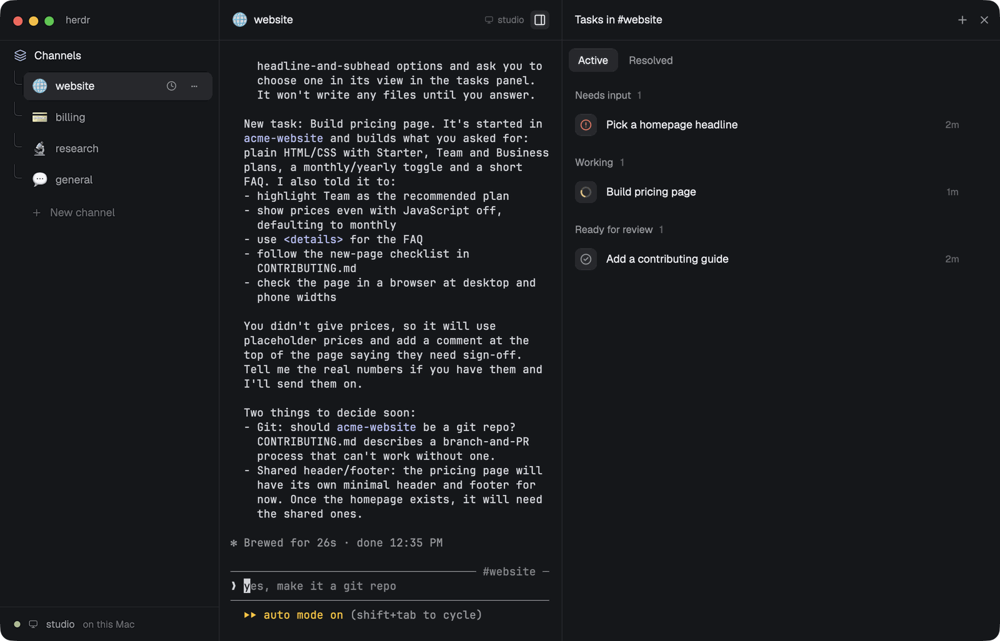
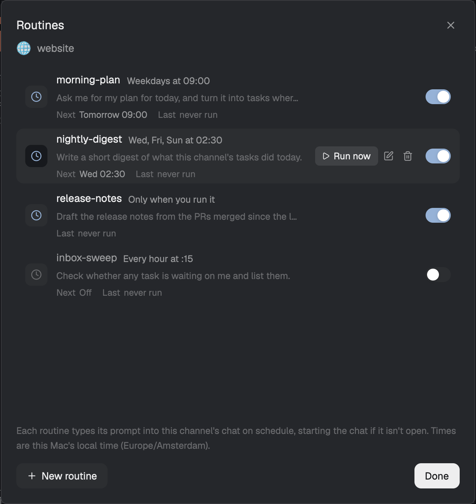

# herdr-channels

Slack-style channels for the [herdr](https://herdr.dev) app, backed by Claude Code and running
entirely on your machine.

A channel groups the work on one topic. Each channel has an icon, a description, a long-lived
Claude Code chat, a list of tasks, and routines: prompts its chat receives on a schedule. A task is a Claude Code background session (`claude --bg`)
that you can open live in the tasks panel next to the chat. The chat can start tasks, read them and
send them messages. When a task finishes or asks a question, the tasks panel shows it, a card above
the chat's prompt lets you answer or dismiss it without the chat taking a turn, and the chat hears
about it with your next message; it is interrupted only when it asked to be.

Everything is local: the channel store is a folder on disk, tasks run under your own `claude`, and
the herdr mod runs every command on the same machine. No server is involved.



## Contents

| Path | Purpose |
|---|---|
| `mods/channels/` | The herdr mod: sidebar, header bar, tasks panel and dialogs |
| `mods/claude/` | The Claude Code mod each channel's chat loads: the [task cards](#task-cards) above its prompt |
| `layouts/channels.json` | The herdr layout that arranges the mod |
| `bin/channels.mjs` | The `channels` command (a Node script, no dependencies) |
| `bin/schedule.mjs` | Routine schedules: parsing, and when a routine is due |
| `install.mjs` | Installer for the command, mod and layout |
| `test/` | Tests for the command and the installer |
| `preview.png`, `docs/` | Screenshots of the layout, taken in a sandbox with demo channels |

## Requirements

- macOS
- The [Herdr desktop app](https://herdr.dev/download) (Herdr.app, Apple silicon), opened at least
  once (this creates `~/.config/herdr-app` and installs `hc`, the herdr-core CLI). The separate
  `herdr` terminal app (TUI) can't load mods, so it isn't enough on its own.
- Node.js 20 or later (`brew install node`)
- [Claude Code](https://claude.com/claude-code), signed in
- `python3` and `git`, both included with the Xcode Command Line Tools

## Installation

1. Install Node.js:

   ```sh
   brew install node
   ```

2. Clone the repository. The installed command runs from the clone, so keep it in place:

   ```sh
   mkdir -p ~/projects && cd ~/projects
   git clone https://github.com/bensoutendijk/herdr-channels
   ```

3. Trust the projects folder in Claude Code. Background sessions only start in a trusted folder.
   Run `claude` there, accept the trust prompt, then type `/exit`:

   ```sh
   cd ~/projects && claude
   ```

4. Install the Herdr desktop app, then open it once so that its configuration folder and `hc`
   exist. It updates itself after this:

   ```sh
   curl -fsSL https://releases.herdr.dev/app/install.sh | sh
   ```

   Or download [Herdr.dmg](https://releases.herdr.dev/app/Herdr.dmg) and drag it to Applications.

5. Run the installer:

   ```sh
   node ~/projects/herdr-channels/install.mjs
   ```

6. If `~/.local/bin` is not on your `PATH`, add it so `channels` is available in a terminal. The mod
   and the chats find the command without this step.

   ```sh
   echo 'export PATH="$HOME/.local/bin:$PATH"' >> ~/.zshrc && exec zsh
   ```

7. Verify the installation:

   ```sh
   herdr-app check ~/.config/herdr-app/mods/channels
   channels create general
   channels list
   ```

   herdr now shows the channels layout with `#general` in the sidebar. Select it to open its chat.
   Press `ctrl-shift-l` to switch between layouts.

### Installer options

The installer:

- writes the `channels` command to `~/.local/bin`,
- copies the mod and layout into `~/.config/herdr-app`,
- copies the task cards mod (`mods/claude`) to `~/.local/share/herdr-channels/chat-mod`, which
  every channel's chat loads,
- selects the channels layout, and
- adds the routines timer: a launchd user agent, `~/Library/LaunchAgents/dev.herdr-channels.tick.plist`,
  that runs `channels tick` every minute (see [Routines](#routines)).

It never overwrites existing files. If a mod or layout named `channels` already exists and was not
installed by this repository, the copy is installed under the next free name (`channels-2`, and so
on). Running the installer again updates a previous installation in place.

| Option | Default | Description |
|---|---|---|
| `--projects <dir>` | `~/projects` | Folder where chats and tasks start |
| `--store <dir>` | `~/.local/state/herdr-channels` | Where channels are stored |
| `--by <name>` | `user` | Name recorded when a task is resolved from the panel |
| `--bin <dir>` | `~/.local/bin` | Where the `channels` command is written |
| `--chat-mod <dir>` | `~/.local/share/herdr-channels/chat-mod` | Where the chats' task cards mod is copied |
| `--app-home <dir>` | `$HERDR_APP_HOME` or `~/.config/herdr-app` | herdr configuration folder |
| `--label <label>` | `dev.herdr-channels.tick` | The launchd label of the routines timer |
| `--no-timer` | | Install without the routines timer |
| `--no-switch` | | Install without selecting the layout |
| `--dry-run` | | Show what would be installed without writing anything |
| `--uninstall` | | Remove what the installer added (see [Uninstalling](#uninstalling)) |

### Updating

```sh
cd ~/projects/herdr-channels && git pull && node install.mjs
```

Pass the same options as the first install (for example `--projects ~/code`). Installing again also
adds the routines timer to an installation that doesn't have it yet.

A chat loads the task cards mod when it starts. A chat that was already running before the update
has no cards until it starts again: type `/exit` in it, and it starts again in a few seconds on the
same session, with its history.

## Usage

- **Channels.** Create a channel with **New channel** at the bottom of the sidebar. Use a channel's
  `···` menu to rename it, edit its instructions (the description its chat reads at startup), set
  up its routines, change its icon or archive it. Drag channels to reorder them. A small clock next
  to a channel's name means it has a routine switched on.

  

- **Chat.** Selecting a channel opens its chat in the main area. Ask the chat to start work and it
  creates a task with `channels start`, writing a brief that the task can follow on its own.
  If the chat ends (`/exit`, a crash, or herdr-core losing it in an update or restart), it starts
  again in a few seconds on the same session, so its history is kept. A chat that stops within
  15 seconds of starting isn't started again on its own: the main area says why, and **Retry** (or
  selecting the channel) tries again.
- **Tasks panel.** The button at the top right toggles the panel. It groups the channel's tasks into
  *Needs input*, *Working* and *Ready for review*. A dot marks a task with an event you haven't
  seen (it finished or asked something since you last opened it). Click a task to open it live. Press the left arrow
  on an empty prompt to return to the list. Each channel's panel keeps its place: switch to another
  channel and back, and it shows the task you had open (or the list, if you went back to it), even
  after Herdr restarts. **+** starts a new session in the projects folder. The
  check mark resolves a task: it is hidden from the panel, and the session is not stopped or deleted.

  

### Task events

The chat's tab runs `channels chat <channel>`. This starts the chat's Claude Code session and a small
listener alongside it. Every 3 seconds the listener reads Claude Code's records of the channel's
tasks (`~/.claude/jobs` and `~/.claude/sessions`). A task finishing, or stopping to ask a question
or show a permission prompt, is an *event*. Each event is delivered at one of three levels:

| Level | When | What happens |
|---|---|---|
| **panel** | Every event | The task gets a dot in the tasks panel until you open it there. |
| **ride-along** | The default, for finishes and questions | The chat takes no turn. The event shows as a [card](#task-cards) above the chat's prompt, and waits in the store to be attached to your next message in the chat as background context. The chat mentions it only if it's relevant or blocking, in one line. |
| **wake** | Only when a registration exists for that task | The listener pastes a `[task report]` (with the task's final message in full) or a `[task question]` into the chat's herdr terminal with `hc send`, which waits until you stop typing. This starts a turn, and the message says why it woke the chat. |

Ride-along uses a Claude Code `UserPromptSubmit` hook. `channels chat` passes it to the chat with
`--settings`, so it applies to that session only and your own settings files are not touched. The
hook runs `channels pending <channel> --hook`, which prints the waiting events as additional
context and marks them delivered. A task's newer event replaces its older one while it waits.
A delivered finish leaves the store; a delivered question stays as a card until it is answered,
dismissed or the task moves on, but isn't attached again.

A registration asks for the chat to be woken by a task's next matching event:

```
channels watch <session> --wake-on finish|question|any [--why <text>]
channels start <channel> --wake-on finish|question|any <brief | ->
channels send <session> --wake-on finish|question|any <text | ->
```

`finish` matches a task finishing, `question` a question or permission prompt, and `any` either.
A registration is used up when it fires; `--wake-on none` cancels one. `--why` is shown in the
wake message (for example, the words the user used to ask to be told). The chat registers when it
is waiting on a task's answer in order to report back, or when you ask it to tell you about a task.
A message `send` delivers to a copy of the task carries the registration to the copy.

An event identical to the last one recorded for its task is dropped at every level: no dot, no
ride-along, no wake, and a registration keeps waiting. That covers a task that did more work but
ended with the same final message, the same question asked again, and a task stopped while it
waited on a question (as `send` does). The store records what each task was last seen as, so
events that happen while the chat is closed are delivered when it next opens, and none arrives twice.

Anything typed into the chat starts a turn, so a prompt that another tool types into it on a
schedule is a wake by nature, and the waiting events ride along with it too.

To see what the listener would do right now, run `channels listen <channel> --once` (it records what
it does). `channels pending <channel>` shows what waits for the chat's next message without taking
it, and `channels seen <session>` clears a task's dot.

### Task cards

Every event that rides along also shows as a card in the chat, in the band directly above its prompt.
Acting on a card never starts a turn of the chat, except **Tell chat**:

| Card | Shows | Buttons |
|---|---|---|
| **A task asks something** (it ended its turn with a question) | The task's name and its question. If the question ends with a short list of choices (`1. Teal`, `- Coral`), they are in a Select, with *Something else…* for your own words; otherwise there is a text field. | **Send** gives the task your answer (`channels send <session> -`), and it carries on. **Open** shows the task in the tasks panel, as clicking it there does. |
| **A task waits on a permission prompt** (or another dialog in its own session) | The task's name and what the prompt asks | **Open**, to answer it in the task's view |
| **A task finished** | One quiet line: `✓ <name> finished` | **Dismiss** drops it. **Tell chat** submits the task's report, whole, to the chat, which starts a turn. |

To reach a card from the keyboard, press `ctrl+x tab` to focus the band, `tab` to move between its
controls, and `enter` to press one; `esc` goes back to the prompt. Clicking works too.

Acting on a card marks its event handled in the store: it leaves the chat's inbox and the task's dot
in the panel clears, so it doesn't also ride along with your next message. A card you don't act on
still rides along; nothing is delivered twice. A question you answer in the task's own view goes
away by itself once the task works again. More than four cards are counted on one line, and the rest
ride along as usual. A registered wake (`--wake-on`, `channels watch`) still wakes the chat with a
turn and shows no card, since the chat is waiting on that answer.

The cards are a Claude Code mod in `mods/claude`. `channels chat` starts the chat's `claude` with
`--plugin-dir` pointing at the installed copy, so only channel chats load it: not tasks, and not
your other Claude Code sessions. Every two seconds it reads the store's `channels.json` and draws
the channel's waiting events; its buttons run `channels`:

```
channels send <session> -          Send
channels open <session>            Open: herdr's channels mod shows the task (herdr-app do channels.open-task)
channels card dismiss <session>    Dismiss
channels card tell <session>       Tell chat: prints the report the mod submits to the chat
```

## Routines

A routine is a prompt that a channel's chat receives on its own, on a schedule: "every weekday at 9,
ask me for my plan". It belongs to one channel and has a name, a prompt, a schedule, a catch-up
window and an on/off switch. The store keeps each routine with a record of its last run.

**Setting one up.** Open **Routines** from the channel's `···` menu. The dialog lists the channel's
routines with their next and last runs. You can add, edit or delete a routine, switch it on or off,
and **Run now** sends its prompt at once without changing the schedule. You can also ask the chat
("every weekday at 9, ask me for my plan"): it sets the routine up with `channels routine add`.



**Schedules** use the Mac's local time:

| Schedule | Runs |
|---|---|
| `weekdays 09:00` | Monday to Friday at 09:00 |
| `daily 18:30` | Every day at 18:30 |
| `hourly :15` | Every hour at a quarter past |
| `weekly fri 16:00` | Fridays at 16:00 |
| `cron 0 9 * * 1-5` | A standard 5-field cron line (minute, hour, day, month, weekday) |

Times may also be written `9`, `9:30` or `9am`.

**When a routine fires**, its prompt is typed into the channel's chat by the chat's listener, the
way a task report the chat registered for is (`hc send`, which waits while you are typing), as a
message that starts with `[routine <name>, scheduled 09:00]`. It wakes the chat: it doesn't wait for
your next message. The chat then decides what to do.

**If the chat isn't running**, the routine starts it in the background: the same chat session, so
its history is kept, in a herdr-core terminal named `chat-<channel id>`. Selecting the channel in
the sidebar then shows that terminal instead of starting a second chat. The mod opens every chat
this way, through `channels chat <channel> --bg`. Running `channels chat <channel>` in another
terminal while the chat runs attaches to it.

**Missed runs.** If the Mac was asleep or off at a routine's time, the run fires once when the Mac
wakes, as long as it is still within the routine's catch-up window (default 60 minutes; `0` means
never run late). Its message then says so: `[routine <name>, scheduled 09:00, running 10:40]`.
Missed runs never stack: after a long sleep only the latest missed time counts. A run outside the
window is skipped and recorded as missed.

**The timer** is the launchd user agent the installer adds. It runs `channels tick` every minute,
and once when the Mac wakes. Each tick records every run that is due in the store before anything is
sent, under the store's lock, so two ticks at once can never fire a routine twice. It then queues the
prompt for the chat, and the chat's listener types it in. What the tick does is logged in `tick.log`
in the store. Check that the timer is loaded with
`launchctl print gui/$(id -u)/dev.herdr-channels.tick`.

```sh
channels routine add general morning-plan --schedule "weekdays 09:00" "Ask me for my plan for today."
channels routine list
channels routine run general morning-plan
```

## Command reference

```
channels [list [<channel>]] [--all] [--json]
channels create <name> [--icon <text>] [--description <text>]
channels archive <name>
channels move <channel> <position>
channels rename <channel> <new-name>
channels icon <channel> <text>
channels describe <name> [--set <text> | --set -]
channels chat <channel>
channels start <channel> [--repo <project>] [--name <name>] [--model <model>] [--permission-mode <mode>] [--wake-on <on>] <brief | ->
channels file <channel> <session> [--name <name>] [--folder <path>]
channels read <session> [--limit <n>] [--json]
channels send <session> [--wake-on <on>] <text | ->
channels watch <session> --wake-on finish|question|any|none [--why <text>]
channels seen <session>
channels dismiss <session> [--by <who>]
channels listen <channel> --once
channels pending <channel> [--hook]
channels card dismiss|tell <session>
channels open <session>
channels chat <channel> --bg [--json]
channels routine list [<channel>] [--json]
channels routine add <channel> <name> --schedule <schedule> [--catchup <window>] [--off] <prompt | ->
channels routine edit <channel> <name> [--schedule <schedule>] [--catchup <window>] [--prompt <text | ->] [--rename <new-name>]
channels routine rm|run|on|off <channel> <name>
channels routine preview <schedule> [--json]
channels tick
```

A catch-up window is a number of minutes or a length such as `15m`, `2h` or `1d`. `channels chat
<channel> --bg` makes sure the chat runs in its herdr-core terminal and prints that terminal.
`channels routine preview` shows a schedule in words with its next three runs, or what is wrong
with it.

`channels send` can only reach a background task that has finished its turn. It stops the idle
session, waits for its process to exit, and resumes the same session with the message. If the
process is still running after 30 seconds (`CHANNELS_STOP_WAIT_MS`), the command fails and starts
nothing. If Claude Code starts a copy of the session instead of continuing it, `send` says so, gives
the copy's session id, and files the copy into the original task's channel in its place; the original
task is marked as superseded by the copy and resolved. Sending to a task that is still working, or
is showing a permission prompt, fails; answer prompts in the task's view instead.

### Environment variables

| Variable | Default | Description |
|---|---|---|
| `CHANNELS_DIR` | `~/.local/state/herdr-channels` | The channel store |
| `CHANNELS_PROJECTS` | `~/projects` | Folder where chats and tasks start |
| `CHANNELS_MACHINE` | host name | Machine name that tasks are recorded under |
| `CHANNELS_PERMISSION_MODE` | `auto` | Permission mode for `start`; empty uses Claude Code's default |
| `CHANNELS_CLAUDE` | `claude` | The Claude Code executable |
| `CHANNELS_HC` | `hc` | The herdr-core executable |
| `CHANNELS_STOP_WAIT_MS` | `30000` | How long `send` waits for a stopped task's process to exit |
| `CHANNELS_CHAT_MOD` | `mods/claude` in the clone | The task cards mod a chat loads |
| `CHANNELS_HERDR_APP` | `herdr-app` | The Herdr desktop app's command, for a card's Open |
| `CHANNELS_HERDR_MOD` | `channels` | The name the herdr mod was installed under |
| `CHANNELS_HERDR_HOME` | herdr's default | The herdr app home a card's Open talks to |

The installed `~/.local/bin/channels` sets `CHANNELS_DIR` and `CHANNELS_PROJECTS` to the values
given to the installer.

The mod's settings are in `~/.config/herdr-app/mods/channels/config.js`, which the installer writes.
They are: the path to the command, extra `PATH` folders, the projects folder and the `--by` name.

## Development

```sh
node --test test/*.test.mjs
```

The tests use a temporary home folder with stand-ins for `claude` and `hc`, so they need neither.
They never load a launchd agent: the installer's tests pass `--no-timer`, and the timer is tested
with a stand-in for `launchctl`. CI runs them on Linux and macOS.

The task cards mod has its own tests, run against Claude Code's plugin engine:

```sh
claude plugin validate mods/claude
claude plugin test mods/claude
```

### Trying a change in a sandbox

To try the app end to end without touching your own setup, give everything a sandbox: a `HOME`, so
the sandbox gets its own herdr-core, Claude Code records and `~/.local/bin`; a herdr app home
(`HERDR_APP_HOME`); and a launchd label of its own. Keep the sandbox path short, because
herdr-core's socket lives under it and macOS caps socket paths at 104 characters.

```sh
export HOME=/tmp/hcsb/home HERDR_APP_HOME=/tmp/hcsb/home/.config/herdr-app
mkdir -p $HOME/Library $HOME/projects
ln -s /Users/<you>/Library/Keychains $HOME/Library/Keychains   # so `claude` stays signed in
/path/to/Herdr.app/Contents/MacOS/Herdr &                       # a second, sandboxed window
node install.mjs --projects $HOME/projects --label dev.herdr-channels.test.$RANDOM
```

Mark the sandbox projects folder as trusted in `$HOME/.claude.json` (`hasTrustDialogAccepted`), or
run `claude` there once. When you are done, run `node install.mjs --uninstall --label <that label>`
with the same environment to unload the agent and remove its plist. Then quit the sandbox window,
run `hc server stop` and delete the folder.

## Uninstalling

```sh
node ~/projects/herdr-channels/install.mjs --uninstall
```

This unloads the routines timer and deletes its plist, and removes the `channels` command and the
mod and layout this repository installed. Only files the installer marked as its own are removed;
a mod or layout called `channels` that came from elsewhere is left alone. The task cards mod is
removed too. Pass `--label`, `--bin`, `--chat-mod` or `--app-home` if you installed with them.

The channel store (`~/.local/state/herdr-channels`), the chats' terminals and any Claude Code
sessions stay in place. Delete them separately if you no longer need them.

## License

MIT; see `LICENSE`. The bundled Lucide icons and Unicode emoji data are covered by their own
licenses; see `THIRD_PARTY_NOTICES.md`.
